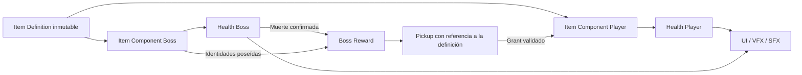

# SoulsNew — análisis y arquitectura inicial propuesta

Fecha: 8 de octubre de 2026 (America/Mexico_City).

**Estado: arquitectura propuesta con Health/modificadores y objetos universales mínimos implementados.** Las secciones de inspección describen el baseline original; las secciones 15 y 16 concretan los incrementos autorizados posteriormente. Las demás clases siguen siendo propuestas. No se ha migrado gameplay existente ni modificado assets; este documento no autoriza ejecutar todo el roadmap.

## 1. Alcance y evidencia

Se inspeccionaron los 87 archivos de `Source` (42 headers, 42 implementaciones y 3 reglas C#), los 5 `.ini` de `Config`, el descriptor del proyecto, configuración Git/IDE y el inventario completo de `Content`. También se consultaron el recibo local de compilación, el registro del editor y configuración generada de Visual Studio para identificar la versión y el entorno.

El contenido tiene **749 `.uasset` y 4 `.umap`**, 753 archivos en total. Se leyeron cadenas de referencias y metadatos de los Blueprints principales de Third Person, los Blueprints/AI/interactuables, animaciones y UI de Combat, y los cuatro mapas, sin guardarlos ni abrir el editor. Esto aporta evidencia de dependencias, pero **no sustituye una inspección de grafos, defaults serializados, Reference Viewer o comportamiento en PIE**. No se afirma que todos los Blueprints carezcan de lógica crítica ni que sus valores coincidan con los defaults C++.

Las carpetas generadas se inventariaron y se consultaron solo archivos diagnósticos concretos; no se analizó cada caché, PDB o archivo intermedio como arquitectura. No se compiló, ejecutó PIE, cocinó contenido ni corrieron tests en esta revisión. Un binario existente demuestra una compilación anterior, no garantiza que el checkout actual compile ni que todas las variantes funcionen.

`SoulsNew.uproject` declara `EngineAssociation: 5.8`. `Binaries/Win64/SoulsNewEditor.target` declara patch 3 y changelist 58210709; `Saved/Logs/SoulsNew.log` confirma **5.8.3-58210709**. Las rutas generadas ubican el motor en `G:/UE_5.8`. No se modificó ni fue necesario inspeccionar su implementación interna.

## 2. Estructura observada

```text
SoulsNew/
  SoulsNew.uproject
  Source/
    SoulsNew.Target.cs
    SoulsNewEditor.Target.cs
    SoulsNew/
      SoulsNew.Build.cs
      SoulsNew.{h,cpp}
      SoulsNewCharacter.{h,cpp}
      SoulsNewPlayerController.{h,cpp}
      SoulsNewGameMode.{h,cpp}
      Variant_Combat/{AI,Animation,Gameplay,Interfaces,UI,...}
      Variant_Platforming/{Animation,...}
      Variant_SideScrolling/{AI,Gameplay,Interfaces,UI,...}
  Config/                         5 archivos .ini
  Content/                        753 paquetes
  Binaries/, Intermediate/, Saved/, DerivedDataCache/, .vs/
  .git/, .gitignore, .gitattributes, .vsconfig
  SoulsNew.sln, SoulsNew.slnx, Automation_SoulsNew.sln/.slnx
```

No se encontraron carpetas locales `Plugins`, `Build` o `docs` antes de esta tarea, ni un `AGENTS.md` previo en el proyecto o sus directorios ascendentes consultados.

### Compilación y dependencias

- Un único módulo **runtime `SoulsNew`**, cargado en `Default`, con `FDefaultGameModuleImpl` y categoría `LogSoulsNew`.
- Targets `Game` y `Editor`, ambos con `BuildSettingsVersion.V7` e include order `Unreal5_8`.
- Dependencias públicas: `Core`, `CoreUObject`, `Engine`, `InputCore`, `EnhancedInput`, `AIModule`, `StateTreeModule`, `GameplayStateTreeModule`, `UMG`, `Slate`. Dependencias privadas vacías.
- El Build.cs exporta include paths del módulo y todas las variantes. No hay separación actual `Public`/`Private` ni módulos por dominio.
- Plugins explícitos: `ModelingToolsEditorMode` solo Editor, `StateTree` y `GameplayStateTree`. El descriptor no enumera todos los plugins que el motor puede habilitar por defecto.
- No hay implementación propia de atributos compartidos, inventario universal, Data Assets de objetos, Gameplay Tags, GAS, subsistemas de run, SaveGame o replicación de estos sistemas en el C++ inspeccionado. `GameplayTags` y `GameplayAbilities` no figuran como dependencias directas del módulo; no confundir disponibilidad transitiva con un contrato declarado.

### Configuración activa

`DefaultEngine.ini` establece `Lvl_ThirdPerson` como mapa inicial del editor y del juego, y `BP_ThirdPersonGameMode` como GameMode global. Combat no es el modo global activo. Las cadenas de los mapas hacen referencia a sus respectivos GameModes; los overrides efectivos deben confirmarse posteriormente en World Settings.

`DefaultInput.ini` selecciona `EnhancedPlayerInput` y `EnhancedInputComponent`. Las acciones y Mapping Contexts se asignan mediante contenido. El proyecto apunta a escritorio y calidad máxima; configura DX12/SM6, iluminación/reflexión dinámica, sombras virtuales, ray tracing y Substrate. El coste real requiere medición en hardware objetivo.

Hay restos del template: `ProjectName=Third Person Game Template`, rutas de editor `/Game/ThirdPersonCPP` que no corresponden al inventario actual, variables de CommonUI sin dependencia directa declarada, y entradas duplicadas de DX12/autoexposición. Mantener los redirects `TP_ThirdPerson -> SoulsNew` hasta revisar referencias; no limpiarlos por apariencia.

### Inventario de contenido

| Carpeta bajo Content | Archivos | Papel observado |
| --- | ---: | --- |
| `__ExternalActors__` | 479 | Actores externos de los cuatro mapas |
| `__ExternalObjects__` | 42 | Objetos externos asociados a mapas |
| `Characters` | 128 | Manny/Quinn, skeleton, materiales, rigs, animaciones |
| `Input` | 9 | Acciones comunes, IMC y widgets/interfaces táctiles |
| `LevelPrototyping` | 29 | Geometría, materiales, puerta, target y jump pad |
| `ThirdPerson` | 5 | Mapa, material y tres Blueprints principales |
| `Variant_Combat` | 31 | Mapa, BP/AI/EQS/StateTree, montages, UI y VFX |
| `Variant_Platforming` | 11 | Mapa, dash, animación, input y VFX |
| `Variant_SideScrolling` | 19 | Mapa, NPC/StateTree, plataformas, pickup, UI/input |

`Collections` y `Developers` existen como directorios, sin archivos en este inventario. Los cuatro mapas contienen referencias a World Partition y paquetes externos. **Los 521 paquetes externos son contenido, no cachés desechables.**

## 3. Arquitectura C++ existente

### Third Person base

`ASoulsNewCharacter` deriva de `ACharacter`. Proporciona cápsula, CharacterMovement, SpringArm, cámara orbital y movimiento relativo al yaw del controlador. Expone `DoMove`, `DoLook` y salto para entrada/UI. No contiene vida ni combate. El mesh, AnimBlueprint y acciones se configuran en el Blueprint derivado; las referencias legibles de `BP_ThirdPersonCharacter` incluyen Quinn Simple y `ABP_Unarmed`.

`ASoulsNewPlayerController` instala Mapping Contexts para el jugador local y crea controles táctiles cuando corresponde. `ASoulsNewGameMode` es un stub. Estas tres clases son una base más pequeña para el futuro slice que las clases Combat.

### Combat

`ACombatCharacter` y `ACombatEnemy` derivan **por separado de ACharacter**, no de `ASoulsNewCharacter`. Ambos implementan `ICombatAttacker` e `ICombatDamageable`, pero duplican vida, trazas, daño, combos y reacción física. Player tiene `MaxHP=5`; Enemy `MaxHP=3` como defaults C++. No son los valores efectivos necesariamente usados por sus Blueprints.

Player incluye input cache, combo, ataque cargado, cámara lateral, WidgetComponent de vida, ragdoll, muerte y timer de respawn. Enemy incluye combos aleatorios, carga por loops, aviso de peligro, muerte con delegate y retirada temporizada. `ApplyHealing` está sin implementar en ambos.

`ACombatPlayerController` escucha la destrucción del pawn y lo recrea en el checkpoint. `ACombatGameMode` crea jugadores locales adicionales y elige PlayerStarts con actor tags `PlayerN`. No existe ciclo roguelike ni persistencia del inventario al recrear el pawn.

La AI usa `ACombatAIController` + `UStateTreeAIComponent`, tareas/condiciones C++, EQS y `ST_CombatEnemy`. Las tareas solicitan ataques y esperan delegates; se usa contexto débil para completarlas y se desuscriben al salir. Es una referencia útil, aunque varias tareas dependen directamente de `ACombatEnemy`. EQS Player consulta el jugador local 0 y exige su existencia mediante `check`.

`ACombatEnemySpawner` genera enemigos uno por uno, escucha su muerte, agenda el siguiente y activa actores al agotarse. No elige objetos ni recompensas. ActivationVolume, CheckpointVolume, DamageableBox, Dummy y LavaFloor son ejemplos de interacción/daño del template. El Dummy reacciona físicamente y no tiene vida ni muerte funcional.

`AnimNotify_DoAttackTrace`, `AnimNotify_CheckCombo` y `AnimNotify_CheckChargedAttack` llaman a la interfaz del owner. Los montages serializados referencian esos notifies. `UCombatLifeBar` expone eventos de presentación Blueprint. Existen hooks C++ para efectos de daño y cámara.

### Platforming y SideScrolling

Platforming incluye salto mantenido, doble salto, wall jump, coyote time y dash con montage, eliminación temporal de gravedad y notify de finalización. Su dash **no es una esquiva Soulslike**: no incorpora stamina, invulnerabilidad, perfect dodge o reglas de combate.

SideScrolling fija movimiento a un plano y cámara lateral; añade plataformas blandas/móviles, interacción, jump pad, NPC con StateTree y UI de coleccionables. `ASideScrollingPickup` acepta un Character controlado por jugador y llama `ASideScrollingGameMode::ProcessPickup`, que incrementa un contador. No posee una definición universal, inventario ni efectos; no sirve como implementación del sistema de objetos.

## 4. Decisiones iniciales propuestas

### Un módulo y composición compartida

Mantener `SoulsNew` como módulo único durante los primeros incrementos y separar carpetas/responsabilidades. No construir ahora un framework genérico, múltiples módulos o un sistema completo de habilidades.

La entidad compatible es un `AActor` con los componentes/capacidades requeridos, expuestos por un contrato pequeño `ISoulsItemOwner`. No necesita ser Player ni heredar de un Character común. Player, Boss, Elite Enemy, Miniboss y Companion usarán las mismas APIs de vida y posesión.

### Núcleo pequeño; decisión GAS antes de ampliar combate

Para el slice de Vitalidad propongo componentes C++ pequeños y un registro de modificadores reversible. **No habilitar GAS en esta tarea.** GAS ofrece componentes de habilidades, atributos y efectos, por lo que merece una evaluación antes de implementar habilidades/status effects extensos. Véase la [documentación oficial de GAS](https://dev.epicgames.com/documentation/unreal-engine/gameplay-ability-system-for-unreal-engine?lang=en-US).

| Opción | Ventaja para SoulsNew | Coste/decisión |
| --- | --- | --- |
| Componentes propios mínimos | Slice acotado y contratos claros | Implementar/probar agregación y ciclo de vida; no evolucionar accidentalmente a un clon de GAS |
| GAS de Epic | Base existente para atributos, habilidades y efectos | Integración, aprendizaje y dependencias `GameplayAbilities`/`GameplayTasks`/`GameplayTags`; cambia diseño de atributos y ejecución |

Si se elige GAS posteriormente, migrar la autoridad de atributos/efectos a ASC/AttributeSet y mantener identidad, inventario, compatibilidad y loot como dominio del juego. No mantener simultáneamente un `MaxHealth` propio y otro de GAS. Las interfaces reducen acoplamiento, pero no eliminan el coste de migración. Multiplayer/predicción o muchos efectos temporales pueden justificar elegir GAS antes del primer slice; esos requisitos aún no están definidos.

### Gameplay Tags y assets de datos

Recomiendo declarar `GameplayTags` como dependencia directa en el primer incremento que los use: aporta vocabulario jerárquico y queries de requisitos, sin requerir GAS. Los `Actor Tags` FName del template no son Gameplay Tags. Los tags deben registrarse en un diccionario controlado; la jerarquía y las queries se describen en [Gameplay Tags de Epic](https://dev.epicgames.com/documentation/en-us/unreal-engine/using-gameplay-tags-in-unreal-engine).

Propongo `USoulsItemDefinition : UPrimaryDataAsset` para la definición única. Asset Manager permite identificar y descubrir Primary Assets; al autorizar la implementación habrá que configurar scan/cook y referencias blandas. No hace falta crear un AssetManager propio si el estándar cubre el caso. Referencia: [Asset Management de Epic](https://dev.epicgames.com/documentation/en-us/unreal-engine/asset-management-in-unreal-engine).

## 5. Responsabilidades y fronteras

Los nombres de esta tabla siguen siendo **propuestos**, excepto `USoulsHealthComponent` y `FSoulsAttributeModifier` (sección 15), y `USoulsItemComponent`, `USoulsItemDefinition` y `FSoulsOwnedItem` (sección 16). Las tres clases base de SoulsNew ya existían.

| Elemento | Responsabilidad | Cuándo |
| --- | --- | --- |
| `USoulsHealthComponent` | BaseMaxHealth, máximo efectivo, vida actual, daño mínimo, estado de muerte; notificaciones | Slice |
| `USoulsItemComponent` | Posesiones por owner, validación, grant/remove, handles y activación de pasivos | Slice |
| `USoulsItemDefinition` | Datos inmutables de identidad, reglas y presentación | Slice, schema mínimo |
| `FSoulsOwnedItem` | Referencia/ID de definición, handle de posesión y estado del owner | Slice |
| `FSoulsAttributeModifier` / handle | Contribución identificada sobre un atributo, fuente y operación | Slice, solo MaxHealth |
| `ISoulsItemOwner` | Acceso a posesión/capacidades sin cast a Player/Boss | Slice |
| `ASoulsItemPickup` | Recompensa en el mundo, recogida transaccional y feedback | Slice |
| `USoulsBossRewardComponent` | Snapshot de objetos de encuentro y recompensa única en muerte confirmada | Slice, un objeto |
| `ASoulsBossCharacter` | Cuerpo/presentación del boss; compone vida y objetos | Slice, boss inerte |
| `USoulsCombatEventComponent` | Eventos locales tipados; suscripción por trigger | Después del slice; muerte puede usar delegate de Health inicialmente |
| `USoulsCombatComponent` | Pipeline de ataques/daño, estado, costes, defensa y ventanas | Incrementos posteriores |
| `USoulsStatusEffectComponent` | Duraciones, periodicidad, refresh y limpieza | Solo cuando existan efectos temporales |
| `USoulsBossLoadoutDefinition` | Pool, pesos y restricciones de asignación de tres | Después del slice |
| `USoulsRunSubsystem : UGameInstanceSubsystem` | Semilla, estado de run y restauración entre mapas | Al introducir runs |

PlayerController traduce entrada; AIController/StateTree decide qué acción solicitar; ambos llaman las mismas APIs de combate. GameMode dirige el encuentro y sus fases. UI y animación observan estado y solicitan acciones validadas. No hacer al RunSubsystem propietario de todos los componentes del mundo.



Dirección de dependencias: Items utiliza contratos de capacidades, atributos y eventos; Health no conoce Vitalidad ni reglas de loot. BossReward conoce posesiones y muerte; Pickup conoce la API de adquisición. Ningún componente depende del widget para funcionar.

## 6. Modelo universal de objetos

### Definición versus estado

| Capa | Datos | No debe contener |
| --- | --- | --- |
| Definición | ID, nombre/icono, ItemTags/categoría, requisitos, ExclusiveGroups, bloqueos, reglas, VFX/SFX | Owner, stacks actuales, cooldowns, timers |
| Posesión por owner | DefinitionId/ref, handle, stack count, registro de concesión y estado de triggers | Copia mutada de la definición |
| Efecto activo | Fuente/handle, objetivo/atributo, operación, magnitud y eventual expiración | Una versión Player/Boss de la regla |
| Pickup | DefinitionId/ref, token de recompensa, estado disponible/recogiendo/consumido | Puntero necesario al boss muerto |

Empezar con structs reflejados para posesión/modificadores. Añadir UObjects de ejecución por efecto solo cuando necesiten polimorfismo o estado complejo. Toda referencia persistente debe tener un ID estable; `FPrimaryAssetId` requiere redirects/migración si se renombra un asset. Los assets retenidos en runtime deben estar protegidos de GC/carga descargada mediante ownership reflejado o handles de carga apropiados.

### Reglas data-driven

Schema conceptual de una regla:

```text
Trigger: OnAcquire / WhileOwned / evento tipado
Conditions: query de tags + condiciones C++ reutilizables sobre el contexto
Effects: lista de primitivas C++ y parámetros (atributo, operación, magnitud)
Duration: Instant / WhileOwned / Timed (Timed y periodicidad se difieren)
StackRules: por definición/owner, límite, refresh y acumulación
Presentation: referencias blandas a VFX, SFX, icono y texto
```

Un pasivo WhileOwned se instala al adquirir y se retira al perder el objeto; no se reaplica cada Tick. Una regla reactiva se suscribe al evento, evalúa condiciones y ejecuta efectos a través del servicio correspondiente. Para Vitalidad solo se necesita un modificador pasivo de MaxHealth; no implementar ahora un editor visual de reglas ni todas las primitivas.

Vitalidad se configurará una sola vez, conceptualmente en `DA_Item_Vitalidad`:

```text
Identidad: Vitalidad
Requisito: Capability.Health
Regla: WhileOwned
Efecto: atributo MaxHealth, operación AdditivePercent, magnitud 0.25
Duración: WhileOwned
Stack: pendiente; la segunda fase técnica permite grants independientes
ExclusiveGroups: ninguno
```

Esto es documentación, no un asset creado. El nombre Vitalidad no aparece en ramas de lógica del Character.

### Atributos y stacking

Para el primer incremento, el registro de contribuciones vive dentro de Health; no crear aún un componente independiente para docenas de atributos vacíos. Si crecen los atributos, extraer un agregador compartido conservando sus handles/API. Stamina/Poise tendrán sus reglas de recursos, sin reutilizar callbacks de muerte de Health.

Regla concretada en la primera fase de Health, siguiendo el orden solicitado para Flat, AdditivePercent y Multiplicative:

```text
MaxHealth = max(MinimumMaxHealth,
                (BaseMaxHealth + Sum(FlatModifiers))
                * (1 + Sum(AdditivePercentModifiers))
                * Product(MultiplicativeModifiers))
```

Para el futuro ejemplo de Vitalidad no hay flat modifiers: `500 * 1.25 = 625`; `100 * 1.25 = 125`. La capa porcentual amplifica ahora base y bonos planos, en lugar de la propuesta original de porcentaje sobre base únicamente: se adopta el orden solicitado en la tarea de implementación. Dos contribuciones de +25% suman +50% en esta capa. Multiplicative usa factores, por ejemplo 1.25, cuyo producto se aplica al final; su identidad es 1. El mínimo efectivo es 1 HP. No hay overrides ni prioridades implícitas.

La política final de duplicados sigue pendiente. En la segunda fase técnica, otorgar la misma definición dos veces crea dos grants con contribuciones independientes (+50% aditivo en este ejemplo). Quitar un grant elimina solo sus handles y recalcula desde base y contribuciones restantes, sin dividir un valor acumulado por 1.25. Cambiar BaseMaxHealth también recalcula usando la misma regla. Esta decisión técnica del incremento autorizado sustituye la propuesta inicial UniquePerOwner; no fija stacking, niveles ni evolución del diseño final.

**Política implementada: PreservePercentage.** Al modificar MaxHealth mientras está vivo, preservar la proporción (`newCurrent = oldCurrent / oldMax * newMax`, limitada al nuevo rango). El componente nace lleno y su inicialización reconcilia la base configurada conservando esa proporción. Así las pruebas de base 500 y 100 terminan en `625/625` y `125/125`; `50/100` pasa a `62.5/125`. También se aplica al quitar modificadores y cambiar la base. Un muerto permanece en 0 y nunca revive por recalcular atributos o por Heal; solo el reinicio C++ explícito de ciclo lo permite. Una política distinta requerirá cambiar esta función y sus tests, sin modificar directamente CurrentHealth desde Blueprint.

### Transacciones y ciclo de vida

Grant: resolver definición -> comprobar owner y compatibilidad -> preparar contribuciones/suscripciones -> registrar posesión y activar -> confirmar -> notificar. Si algo falla, revertir lo preparado. Remove: retirar exclusivamente handles/timers/suscripciones de la posesión -> borrar registro -> notificar. La misma función se usa para boss, jugador y otras entidades.

Duplicados de notificaciones no son adquisiciones nuevas: usar handle/token para idempotencia. No serializar delegates, punteros a actores destruidos o handles temporales como progreso guardado. En el futuro se guardarán IDs, stacks y datos necesarios; la carga reconstruirá efectos sin duplicarlos.

## 7. Compatibilidad y asignación del boss

### Vocabulario propuesto

- Capacidades: `Capability.Health`, `Capability.Dodge`, `Capability.Parry`, `Capability.Melee`.
- Categorías: `Item.Category.Defense`, `Item.Category.Offense`, `Item.Category.Utility`.
- Estado: `State.Dead`, `State.Attacking`, `State.Dodging`, `State.Parrying`.
- Exclusión: `Item.Exclusive.DodgeReplacement` para objetos que reemplazan la esquiva.

Los nombres se documentarán/registrarán como contrato; categorías no implican exclusión. Un objeto puede reservar varios grupos. Definir matching exacto o jerárquico por campo: grupos exclusivos inicialmente por igualdad exacta; requisitos/bloqueos mediante queries explícitas. Cambios de jerarquía de tags pueden cambiar compatibilidad y requieren validación de datos.

`CanAcquire` valida:

1. Definición válida, estado del receptor y capacidades reales. Los tags de capacidad no deben mentir sobre componentes disponibles.
2. RequiredOwnerQuery y BlockedOwnerQuery; no bloquear Vitalidad por `Owner.Player`/`Owner.Boss`.
3. Política de duplicados/stacks.
4. Colisiones de ExclusiveGroups con todas las posesiones.
5. Requisitos del inventario y conflictos **en ambas direcciones**: los bloqueos de A hacia B y de B hacia A.
6. Si el candidato aporta capacidades/tags, validar también que el conjunto resultante conserve los requisitos de los objetos existentes. En la primera versión, limitar requisitos a capacidades estables del owner para evitar ciclos entre objetos.

Dos reemplazos de esquiva distintos reservan `DodgeReplacement` y no coexisten. La habilidad base es el fallback del sistema de acciones; retirar el reemplazo restaura ese fallback. Esta resolución debe vivir en C++ cuando se implemente Dodge, sin dos objetos sobrescribiendo una referencia en Blueprint.

### Tres objetos aleatorios compatibles

La selección debe trabajar sobre un catálogo explícito y pesos validados, con semilla de run/encuentro y candidatos ordenados establemente por ID. Filtrar primero incompatibilidades con owner y luego construir un conjunto de **tres diferentes**. Una búsqueda finita con backtracking permite resolver conflictos entre candidatos y no descartar un trío existente por una primera elección greedy desafortunada.

Definir la política de ponderación antes de producción: una exploración en orden aleatorio ponderado no garantiza distribución uniforme sobre todos los tríos válidos. El primer incremento de tres puede usar un catálogo pequeño y elegir entre tríos válidos enumerados; para un catálogo grande será necesario un algoritmo y presupuesto de búsqueda documentados. Agotar ese presupuesto es un fallo de búsqueda, no una prueba de que no existe trío.

Si no se puede formar/activar el conjunto, devolver error con causas; el boss sigue sin activar combate. No completar con duplicados, objetos incompatibles ni pasivos que solo aparecen visualmente. Validar pools en edición y en runtime porque capacidades/inventario pueden cambiar.

### Inicialización y muerte

No confiar en el orden entre BeginPlay de componentes y OnPossess de AI. Flujo explícito para actor colocado o generado:

```text
Creado/inactivo
 -> establecer atributos base y capacidades
 -> resolver datos y loadout
 -> conceder objetos mediante la API universal
 -> recalcular atributos y establecer vida inicial llena
 -> registrar snapshot de recompensa y oyentes de muerte
 -> marcar Ready
 -> habilitar daño/input/AI del encuentro
```

Si se usa spawn diferido, complementarlo con ese gate Ready; no asumir que por sí solo resuelve toda inicialización. La selección de recompensa usa el snapshot/posesiones del encuentro antes de la limpieza de efectos. Para el modelo inicial, el loadout del boss permanece fijo durante el encuentro; objetos temporales generados por procs no entran accidentalmente en su pool de recompensa.

Muerte confirmada -> marcar transición una sola vez -> seleccionar uniformemente uno de los tres IDs del encuentro -> generar un pickup con ese ID -> confirmar token de recompensa -> limpiar efectos/AI -> presentación/retirada del cadáver. Si el spawn del pickup falla, conservar la recompensa pendiente y el mismo ID para reintento controlado; no marcarla entregada ni volver a sortear por cada intento.

La posesión del jugador es nueva: mantiene definición y mecánica, pero no hereda punteros, cooldowns, vida o timers del cadáver. Si más adelante un objeto tiene parámetros aleatorios que cambian su mecánica, esos parámetros del ejemplar deben viajar en la recompensa; no rerollearlos al recoger.

Pickup: verificar compatibilidad -> reservar transacción -> otorgar -> consumir. Un objeto incompatible o ya poseído bajo UniquePerOwner permanece disponible y explica la razón; no se destruye ni reemplaza otro silenciosamente. La política de duplicados monetizables/recompensas alternativas queda pendiente.

## 8. Combate y eventos futuros

Usar un flujo C++ único: solicitud -> validación de estado/costes -> ventana de acción -> detección -> resolución defensiva -> daño/poise aplicado -> transición de vida -> eventos confirmados -> presentación. Los notifies pueden señalar ventanas, pero el estado C++ acepta/rechaza e identifica la acción.

Contexto conceptual de evento: tipo/tag, EventId/CauseId, instigador, receptor, actor origen, item/effect fuente cuando aplique, ataque/acción, magnitud solicitada y realmente aplicada, impacto, tags/resultados y tiempo. Referencias a actores en contextos diferidos deben ser débiles o snapshots. No crear ahora todos estos campos ni el bus completo para un pasivo.

| Evento | Emisor/semántica propuesta |
| --- | --- |
| OnHit | Instigador; contacto válido resuelto. Payload diferencia hit bloqueado, parry y daño positivo |
| OnDamageReceived | Receptor; reducción de vida positiva confirmada, magnitud efectiva limitada a la vida perdida |
| OnDodge / OnPerfectDodge | Owner; Dodge al iniciar acción válida; PerfectDodge cuando una amenaza real evitada cumple la ventana, una vez por amenaza |
| OnParry / OnPerfectParry | Defensor; ataque realmente interceptado, Perfect solo dentro de ventana definida |
| OnKill | Instigador acreditado; una vez al confirmar muerte del objetivo; daño ambiental puede no tener killer |
| OnDeath | Receptor; única transición Alive -> Dead, antes de invalidar contexto/recompensa |
| OnLowHealth | Owner; entrada al umbral, con histéresis/rearme. No emitir cada Tick mientras está bajo |

Normal y perfecto deben tener relación explícita: un resultado perfecto también puede tener la categoría normal en su payload, pero una regla que escucha ambos no debe dispararse dos veces por la misma acción. Definir fases para low health, muerte y kill; una muerte no debe provocar un proc de low health que reanime implícitamente al receptor.

Antes de objetos reactivos, introducir protección de reentrada: IDs causales, política para eventos originados por procs, máximo de profundidad/presupuesto y cola de mutaciones de inventario. Evitar bucles como OnHit -> daño extra -> OnHit -> daño extra. Los modificadores previos al daño usan una fase de resolución controlada, no un observer de daño confirmado que reescribe el pasado.

## 9. Riesgos técnicos detectados

| Riesgo/evidencia | Consecuencia | Tratamiento propuesto |
| --- | --- | --- |
| Vida/trazas/ataques duplicados en CombatCharacter y CombatEnemy | Mecánicas Player/Boss divergen; objetos aplicados en un solo lado | Núcleo común por componentes; no copiar la variante al nuevo boss |
| Vida/UI/ragdoll juntas; `check(LifeBarWidget)` y desreferencias en ambos personajes | La ausencia de widget puede impedir iniciar gameplay | Vida independiente; presentación opcional |
| `MaxHP` de CombatCharacter tiene ClampMax 100 en editor | Restricción inapropiada para vida modificada/bosses | Nuevo atributo sin ese límite arbitrario; clamps de recursos en C++ |
| `TakeDamage` resta daño bruto, sin clamp de entrada/HP; devuelve cantidad solicitada | Vida negativa/curación por daño negativo y procs con magnitud incorrecta | Validar finitud/no negatividad y devolver daño realmente aplicado |
| `HandleDeath` expuesto vía interfaz, sin guard interno propio | Llamadas directas repetidas pueden repetir callbacks | Transición idempotente en Health y token de recompensa |
| Montages: se establece `bIsAttacking` antes de validar reproducción; dash pone gravedad 0 antes de reproducir | Datos faltantes pueden dejar ataques/dash atascados | Validar assets y limpiar estados por fallo/interrupción/EndPlay |
| `RandRange(1, ComboSectionNames.Num()-1)` en enemigo | Configuración vacía/pequeña no validada | Validación de datos y failure paths; no importar sin revisión |
| Sweeps recorren hits sin deduplicación por actor/AttackId | Posibles impactos/procs múltiples sobre un objetivo | Set de objetivos por ventana/ataque; política multihit explícita |
| Enemy usa actor tag `Player`; EQS consulta player 0; tareas castean CombatEnemy | Dificulta compañeros, facciones y objetivos universales | Capacidades/relaciones de equipo y contratos; aplazar AI compleja |
| Respawn por OnDestroyed recrea pawn; muerte/retirada limpia estado | Pérdida de objetos o respawn durante limpieza si se reutiliza sin cambios | Distinguir derrota, fin de run y teardown; persistencia cuando se diseñe |
| Spawner escucha la muerte después de SpawnActor | Inicialización dentro de BeginPlay puede ocurrir antes del listener | Gate Ready y oyentes antes de permitir daño |
| Definición compartida mutada, grant repetido o retirada sin handle | Boss afecta datos del player; porcentajes acumulados/efectos huérfanos | Data Asset inmutable, estado por owner y contribuciones identificadas |
| Selección greedy o catálogo insuficiente | Boss con menos de tres o combinación inválida | Solver finito, validación de pools y resultado fallido explícito |
| Objetos ilimitados con Tick o búsquedas globales por objeto | Coste escala con inventario y enemigos | Pasivos agregados y dispatch por trigger; medir catálogo representativo |
| Soft refs sin scan/cook del catálogo | Funciona en editor y faltan objetos en build | Asset Manager y smoke test empaquetado |
| World Partition y 521 paquetes externos | Borrado/movimiento manual rompe mapas/referencias | Gestionar con herramientas del editor y dependencias revisadas |
| DX12/SM6, ray tracing, Substrate y calidad máxima | Coste/compatibilidad del hardware aún desconocidos | Fijar hardware objetivo y perfilar; no optimizar prematuramente |
| Rutas/editor/nombre residual y entradas duplicadas en Config | Confusión de mapas/configuración | Limpieza puntual futura, conservando redirects necesarios |
| Todo en dependencias públicas e includes globales de variantes | Acoplamiento y coste de compilación | Nuevas áreas con includes explícitos; revisar Public/Private sin mover todo ahora |
| Sin pruebas propias de contratos; logs muestran `LogAutomationTest: Error: Condition failed` en inicio | Baseline no acreditado como sano | Investigar origen en fase de verificación; el extracto no atribuye esos errores al gameplay |

`.gitignore` excluye correctamente carpetas generadas y soluciones. `.gitattributes` asigna LFS a `.uasset`/`.umap`. La consulta `git lfs ls-files` falló por acceso a `.git` en este entorno; **no se verificó la operatividad de LFS, su tracking efectivo ni disponibilidad remota**. Verificar un checkout/cook reproducible antes de colaboración con assets. No cambiar Git ni LFS en esta tarea.

## 10. Qué reutilizar y qué dejar fuera

| Parte actual | Decisión propuesta |
| --- | --- |
| SoulsNewCharacter + PlayerController | Base de locomoción/cámara/Enhanced Input; añadir componentes en un incremento posterior |
| ThirdPerson GameMode y mapa | Referencia funcional; preferir un mapa de prueba nuevo y pequeño para el slice cuando se autorice |
| Manny/Quinn, skeleton, rigs, ABP_Unarmed, BS_Idle_Walk_Run | Representación provisional; confirmar skeleton y grafos antes de reutilizar |
| LevelPrototyping | Graybox de arena y representación temporal del pickup |
| AM_ComboAttack / AM_ChargedAttack y notifies C++ | Referencia de timing/interfaces, no autoridad final de daño ni diseño Soulslike |
| CombatLifeBar / UI_LifeBar / NS_Damage / CameraShake | Presentación provisional desacoplada, sin arrastrar dependencia UI -> vida |
| Combat StateTree/EQS/spawner | Referencia para futuros enemigos; no necesarios para el boss inerte del slice |
| Interfaces Combat/SideScrolling | Referencia de separación de contratos; no asumir que cubren items ni requisitos nuevos |
| Platforming dash | Referencia de animación/movimiento; no reutilizar como Dodge definitivo |
| SideScrollingPickup | Referencia de overlap/feedback; reemplazar el grant basado en GameMode/contador en el sistema nuevo |

Ignorar en el primer slice: split screen/local multiplayer, touch UI si la plataforma objetivo es PC, wall jump/doble salto, cámara lateral, plataformas blandas/móviles, armas Pistol/Rifle, lava/checkpoints y AI de combate compleja. Mantenerlos por ahora.

Candidatos a retirar posteriormente: mapas y clases de Platforming/SideScrolling, contenido Pistol/Rifle no usado, input/UI táctil si queda fuera de las plataformas, y clases Combat cuando sus referencias útiles hayan sido migradas. **No hay eliminación autorizada ni prueba de que sean assets huérfanos.** Antes de retirarlos: revisar Reference Viewer, referencias nativas/soft refs, mapas, cook, redirects y validar PIE/build. No quitar StateTree/GameplayStateTree mientras el módulo compile fuentes que los requieren.

## 11. Organización futura sugerida

```text
Source/SoulsNew/
  Core/          contratos y vocabulario de tags/contextos
  Characters/    composición de player/boss/enemy
  Attributes/    Health y modificadores; más recursos cuando se necesiten
  Items/         definición, posesión, compatibilidad y primitivas
  Interaction/   pickup y recogida
  Combat/        acciones, eventos, ventanas y resolución (posterior)
  AI/            decisiones y adaptadores de StateTree (posterior)
  Run/           estado/semilla/progresión de run (posterior)
  UI/            puentes de presentación
  Tests/         contratos que requieren validación
Content/SoulsNew/
  Items/Definitions/
  Characters/{Player,Bosses,Enemies}/
  Blueprints/
  Input/
  UI/
  Maps/Tests/
```

Crear solo áreas con implementación real. El contenido del template conserva sus rutas durante la transición. Adoptar `Public`/`Private` para nuevas fronteras exportadas cuando proceda; no reorganizar hoy el módulo ni los assets existentes.

## 12. Roadmap incremental y criterios de salida

| Fase | Entrega acotada | Verificación/criterio de salida |
| --- | --- | --- |
| 0 — esta tarea | Análisis, AGENTS.md y esta propuesta | Solo documentación; archivos existentes preservados |
| 1 — baseline y contrato | Confirmar build Editor 5.8.3, abrir ThirdPerson/Combat en PIE sin guardar cambios accidentales, resolver origen de errores de log; fijar política de vida actual y decisión de backend | Baseline reproducible; alcance del slice y dependencias explicados |
| 2 — Health mínimo | Componente con base/máximo/actual, daño controlado, modificadores con handles y muerte única; owner Player 100 y Boss 500 | Pruebas de daño/clamp/recalculo/retirada y UI opcional; sin stamina/poise |
| 3 — objeto universal mínimo | Definición + ItemComponent + requisito real Health; grants técnicos independientes (incremento implementado en sección 16) | La misma referencia produce 625 y 125; retirada individual, aislamiento y transacciones probados; política final de duplicados pendiente |
| 4 — cerrar primer vertical slice | Boss inerte con Vitalidad, muerte por daño de prueba autorizado, recompensa única y pickup | Flujo completo 500 -> 625 -> muerte -> pickup -> 100 -> 125; recolección y muerte repetidas no duplican efectos/drop |
| 5 — tres objetos compatibles | Catálogo pequeño adicional, tags/grupos/bloqueos, semilla y selección de tres | Los tres efectos existen en runtime; drop pertenece al trío; pool insuficiente y combinaciones bloqueadas devuelven fallo |
| 6 — combate básico | Daño/hit/eventos confirmados, Light Attack y enemigo mínimo; después Heavy/Charged, stamina y Dodge | Sin dobles hits/procs; mismas APIs desde player y AI; interrupciones/costes consistentes |
| 7 — defensa y efectos reactivos | Perfect Dodge, Parry/Perfect Parry, Poise/Stagger, status effects y triggers por incrementos separados | Ventanas/causalidad/stack/duración y limpieza probadas; decisión GAS resuelta antes de esta expansión |
| 8 — loop roguelike | Estado/semilla de run, progreso de encuentros, persistencia y reset de inventario según diseño | Nueva run no arrastra efectos; transiciones/restauración coherentes; smoke test empaquetado |

Las fases 2–4 forman un único slice jugable mínimo con incrementos revisables. La fase 3 puede usar fixtures de prueba para demostrar ambos owners; la adquisición del jugador dentro del flujo jugable ocurre mediante el drop de fase 4.

**Primero:** Health + modificadores, definición/posesión universal, muerte/drop y recogida. Usar daño de prueba mediante API para matar al boss; no construir ataques completos ni AI para demostrar Vitalidad. No implementar los tres objetos aleatorios en el slice: el loadout de prueba tiene uno, con excepción explícita y separada de la regla de producción.

Pruebas futuras mínimas del slice:

- Boss sin objeto `500/500`; con Vitalidad `625/625` y un solo handle.
- Player sin objeto `100/100`; tras recoger la misma definición `125/125` bajo la política propuesta.
- Un actor compatible adicional obtiene el mismo porcentaje; uno sin Health rechaza sin efectos parciales.
- Retirada vuelve al máximo base; reequipar no produce deriva; cambiar base recalcula.
- Retirar dos veces el mismo grant no duplica operaciones; la política de duplicados de adquisición queda pendiente. Doble overlap no duplica una recogida; adquisición rechazada no consume el pickup.
- Muerte una sola vez; Destroy por limpieza no da loot; el pickup conserva datos aunque se destruya el cadáver.
- Fallo al crear pickup no pierde la recompensa ni cambia el sorteo.
- Repetir en PIE y en build empaquetada al configurar catálogo/cook.

## 13. Decisiones pendientes antes de escalar

Fijar plataforma/hardware objetivo, single player o multiplayer, adquisición de objetos duplicados, overrides/prioridades de atributos si se necesitan, conservación de objetos al morir/cambiar mapa, meta-progresión entre runs y posible GAS antes de escalar combate. PreservePercentage y las tres capas de cálculo ya quedaron concretadas en la primera fase de Health. No implementar soluciones a las demás preguntas sin el incremento correspondiente.

## 14. Archivos existentes inspeccionados

### Lectura de fuente y configuración

En la lista siguiente, `{h,cpp}` significa que se inspeccionaron ambos archivos. Las entradas suman los 42 pares y las 3 reglas C# actuales.

```text
SoulsNew.uproject
.gitignore
.gitattributes
.vsconfig
Config/DefaultEditor.ini
Config/DefaultEditorPerProjectUserSettings.ini
Config/DefaultEngine.ini
Config/DefaultGame.ini
Config/DefaultInput.ini
Source/SoulsNew.Target.cs
Source/SoulsNewEditor.Target.cs
Source/SoulsNew/SoulsNew.Build.cs
Source/SoulsNew/SoulsNew.{h,cpp}
Source/SoulsNew/SoulsNewCharacter.{h,cpp}
Source/SoulsNew/SoulsNewGameMode.{h,cpp}
Source/SoulsNew/SoulsNewPlayerController.{h,cpp}
Source/SoulsNew/Variant_Combat/CombatCharacter.{h,cpp}
Source/SoulsNew/Variant_Combat/CombatGameMode.{h,cpp}
Source/SoulsNew/Variant_Combat/CombatPlayerController.{h,cpp}
Source/SoulsNew/Variant_Combat/AI/CombatAIController.{h,cpp}
Source/SoulsNew/Variant_Combat/AI/CombatEnemy.{h,cpp}
Source/SoulsNew/Variant_Combat/AI/CombatEnemySpawner.{h,cpp}
Source/SoulsNew/Variant_Combat/AI/CombatStateTreeUtility.{h,cpp}
Source/SoulsNew/Variant_Combat/AI/EnvQueryContext_Danger.{h,cpp}
Source/SoulsNew/Variant_Combat/AI/EnvQueryContext_Player.{h,cpp}
Source/SoulsNew/Variant_Combat/Animation/AnimNotify_CheckChargedAttack.{h,cpp}
Source/SoulsNew/Variant_Combat/Animation/AnimNotify_CheckCombo.{h,cpp}
Source/SoulsNew/Variant_Combat/Animation/AnimNotify_DoAttackTrace.{h,cpp}
Source/SoulsNew/Variant_Combat/Gameplay/CombatActivationVolume.{h,cpp}
Source/SoulsNew/Variant_Combat/Gameplay/CombatCheckpointVolume.{h,cpp}
Source/SoulsNew/Variant_Combat/Gameplay/CombatDamageableBox.{h,cpp}
Source/SoulsNew/Variant_Combat/Gameplay/CombatDummy.{h,cpp}
Source/SoulsNew/Variant_Combat/Gameplay/CombatLavaFloor.{h,cpp}
Source/SoulsNew/Variant_Combat/Interfaces/CombatActivatable.{h,cpp}
Source/SoulsNew/Variant_Combat/Interfaces/CombatAttacker.{h,cpp}
Source/SoulsNew/Variant_Combat/Interfaces/CombatDamageable.{h,cpp}
Source/SoulsNew/Variant_Combat/UI/CombatLifeBar.{h,cpp}
Source/SoulsNew/Variant_Platforming/PlatformingCharacter.{h,cpp}
Source/SoulsNew/Variant_Platforming/PlatformingGameMode.{h,cpp}
Source/SoulsNew/Variant_Platforming/PlatformingPlayerController.{h,cpp}
Source/SoulsNew/Variant_Platforming/Animation/AnimNotify_EndDash.{h,cpp}
Source/SoulsNew/Variant_SideScrolling/SideScrollingCameraManager.{h,cpp}
Source/SoulsNew/Variant_SideScrolling/SideScrollingCharacter.{h,cpp}
Source/SoulsNew/Variant_SideScrolling/SideScrollingGameMode.{h,cpp}
Source/SoulsNew/Variant_SideScrolling/SideScrollingPlayerController.{h,cpp}
Source/SoulsNew/Variant_SideScrolling/AI/SideScrollingAIController.{h,cpp}
Source/SoulsNew/Variant_SideScrolling/AI/SideScrollingNPC.{h,cpp}
Source/SoulsNew/Variant_SideScrolling/AI/SideScrollingStateTreeUtility.{h,cpp}
Source/SoulsNew/Variant_SideScrolling/Gameplay/SideScrollingJumpPad.{h,cpp}
Source/SoulsNew/Variant_SideScrolling/Gameplay/SideScrollingMovingPlatform.{h,cpp}
Source/SoulsNew/Variant_SideScrolling/Gameplay/SideScrollingPickup.{h,cpp}
Source/SoulsNew/Variant_SideScrolling/Gameplay/SideScrollingSoftPlatform.{h,cpp}
Source/SoulsNew/Variant_SideScrolling/Interfaces/SideScrollingInteractable.{h,cpp}
Source/SoulsNew/Variant_SideScrolling/UI/SideScrollingUI.{h,cpp}
```

### Lectura parcial de diagnóstico y metadatos binarios

- `Binaries/Win64/SoulsNewEditor.target`: cabecera/version, no auditoría de todas sus dependencias de motor.
- `Saved/Logs/SoulsNew.log`: versión, diagnósticos y contexto alrededor de errores de inicialización; sin atribuir causa no comprobada.
- `Intermediate/ProjectFiles/SoulsNew.vcxproj`: rutas/include/build generados; no fuente de reglas del proyecto.
- `Content/ThirdPerson/Blueprints/BP_ThirdPerson{Character,GameMode,PlayerController}.uasset`.
- `Content/Variant_Combat/Blueprints/`: los cinco BP directos, los siete assets en `AI` y los cinco BP de `Interactables`.
- `Content/Variant_Combat/Anims/{ABP_Manny_Combat,AM_ComboAttack,AM_ChargedAttack}.uasset` y `UI/UI_LifeBar.uasset`.
- `Content/ThirdPerson/Lvl_ThirdPerson.umap`, `Content/Variant_Combat/Lvl_Combat.umap`, `Content/Variant_Platforming/Lvl_Platforming.umap`, `Content/Variant_SideScrolling/Lvl_SideScrolling.umap`.
- Todos los paquetes restantes de Content: inventario de ruta/extensión/tamaño y hashes de conservación; no análisis semántico de sus grafos.

Las soluciones, DLL/PDB, caches y otros archivos generados solo se identificaron/inventariaron cuando no se mencionan explícitamente como lecturas. No se trataron como código propio ni se editaron.

## 15. Primera implementación: Health y modificadores

El incremento autorizado crea `Attributes/SoulsHealthComponent.{h,cpp}`, `Attributes/SoulsAttributeModifier.h` y `Tests/SoulsHealthComponentTests.cpp` dentro del módulo existente. No añade dependencias, plugins, objetos, inventario, UI ni conexión a Combat, Player o BP_CombatEnemy. La integración en actores de gameplay queda pendiente; una prueba usa exclusivamente un Actor genérico y un mundo transitorio sin guardar assets.

`USoulsHealthComponent` deriva de UActorComponent, no tiene Tick ni requisitos de Character/controlador/UI. Mantiene BaseMaxHealth configurada, MaxHealth derivada y CurrentHealth limitada. C++ puede cambiar la base, añadir/encontrar/quitar contribuciones y reiniciar explícitamente la vida. Blueprint solo consulta vida, máximo, porcentaje/estado de muerte, solicita daño/curación y escucha eventos. La base es configurable en Details, pero no tiene setter Blueprint. Los structs/operaciones internos y el registro no son tipos expuestos a Blueprint.

Cada `FSoulsAttributeModifier` tiene un **FGuid válido aportado por el llamador**, operación y magnitud. Ese ID debe mantenerse para encontrar/quitar su contribución y reconstruirse desde datos persistentes cuando exista guardado; el componente no implementa SaveGame. La unicidad es por componente: se rechaza un ID repetido, incluso con otro valor; propietarios distintos pueden usar el mismo ID de forma independiente. Find devuelve copia, sin punteros al almacenamiento. Los cambios se validan sobre un registro candidato antes de confirmarse.

El registro se ordena por las cuatro palabras A/B/C/D del GUID antes de agregar. Flat y AdditivePercent se suman por separado; Multiplicative se multiplica en ese orden estable. El cálculo usa double y devuelve float; el resultado para un mismo conjunto de IDs/valores no depende del orden de inserción. Esto no promete determinismo bit a bit entre todas las plataformas, ni idéntica vida actual después de secuencias intermedias distintas con redondeo. Las fracciones porcentuales usan 0.25 para +25%; factores multiplicativos deben ser positivos. Flat y porcentajes permiten valores negativos finitos; el resultado se limita inferiormente a 1. Bases menores que 1, NaN/Infinity, operaciones desconocidas, IDs inválidos, factores no positivos y desbordamientos se rechazan sin cambios ni eventos. No se cambia permanentemente la base al añadir contribuciones.

TakeDamage y Heal devuelven la cantidad realmente perdida/recuperada. Peticiones no positivas/no finitas son no-ops. Heal no revive; ResetHealthForNewLife, solo C++, conserva los modificadores, llena la vida y rearma Death. La inicialización normal reconcilia valores configurados sin reiniciar un muerto. Una configuración inicial inválida produce un warning y usa base 100.

Los tres eventos tienen versiones nativas C++ y Blueprint: HealthChanged y MaxHealthChanged incluyen componente, valor anterior y nuevo; Death incluye componente. El estado completo se confirma antes de notificar; el orden es MaxHealthChanged -> HealthChanged -> Death, omitiendo cambios inexistentes. Cada evento nativo se publica antes de su equivalente Blueprint. Death se emite una vez por ciclo, y el estado muerto ya es visible en el callback de cambio letal. Las APIs de escritura requieren game thread y **rechazan mutaciones reentrantes durante todos esos callbacks** (false/0); consumidores que necesiten reaccionar con otra escritura deben diferirla. No hay colas, timers o bus de combate implícitos en esta fase.

La suite `SoulsNew.Health` contiene 15 Unreal Automation Tests compilados bajo WITH_DEV_AUTOMATION_TESTS: los casos A–H solicitados y pruebas de IDs, orden determinista/cancelación numérica, validación atómica, ciclos de vida, orden de eventos/reentrada, recálculo/suelo y configuración en Actor genérico. El backend elegido para este incremento es el núcleo propio mínimo; GAS permanece como evaluación futura antes de expandir combate.

Validación de este incremento: SoulsNewEditor Win64 Development compilado con UE 5.8.3 mediante UBT (UHT y compilación nativa, no Live Coding); sin warnings de compilación. Se utilizaron `-NoPCH -NoUBA -MaxParallelActions=1` para evitar la presión de memoria observada con el PCH compartido, sin cambiar Build.cs ni ajustes del motor. UnrealEditor-Cmd ejecutó `Automation RunTests SoulsNew.Health` con `/Engine/Maps/Entry`, `-nullrhi -nosound -unattended`: **15 Success, 0 fallos, 0 warnings en los tests**, salida 0. Evidencia local generada: `Saved/Logs/HealthPhase-EditorBuild-Final.log`, `Saved/Logs/HealthPhase-Automation.log` y `Saved/Automation/HealthPhase/index.json`. El arranque emitió 14 mensajes genéricos `LogAutomationTest: Error: Condition failed`, también presentes en el log previo del proyecto, y un warning de layout del editor; su causa queda sin diagnosticar y no se atribuye a la suite nueva. Esta ejecución no valida PIE, presentación Blueprint ni una build empaquetada.

## 16. Segunda implementación: objetos universales mínimos

El incremento crea `Items/SoulsItemDefinition.{h,cpp}`, `Items/SoulsItemComponent.{h,cpp}` y `Tests/SoulsItemComponentTests.cpp`. La misma definición transitoria de Vitalidad se concede a Actors genéricos de 100 y 500 HP mediante datos `MaxHealth / AdditivePercent / 0.25`. No hay ramas por ItemId, Player o Boss, ni integración en actores/Blueprints/mapas existentes. No se crean assets, drops, pickups, RNG de objetos, UI, persistencia, GAS ni otros sistemas de combate.

### Definición y schema de efectos

`USoulsItemDefinition : UPrimaryDataAsset` contiene únicamente datos privados editables en defaults: ItemId lógico FName, DisplayName, Description, Effects, ItemTags (también categorías) y ExclusiveGroups. La API runtime solo ofrece lectura const; `CreateTransient` copia los datos una vez para construcción C++/tests, con RF_Transient. No almacena dueño, grants, modificadores, vida ni timers. La inmutabilidad es el contrato de la API runtime; no pretende impedir modificaciones por herramientas de edición o reflexión externa.

`FSoulsItemEffect` es un struct reflejado de Attribute, Operation y Magnitude. Solo MaxHealth es un destino implementado; destinos desconocidos se rechazan. Reutiliza `ESoulsAttributeModifierOperation`, ahora UENUM de configuración sin BlueprintType ni nuevas APIs de mutación Blueprint. Los tres tipos existentes (Flat, AdditivePercent, Multiplicative) se interpretan por Health; Vitalidad es solo una configuración en las pruebas. Efectos pasivos duran mientras exista su grant.

Se añade **GameplayTags** como dependencia pública directa porque los headers del schema usan FGameplayTagContainer. Es un módulo existente del motor, sin plugin nuevo ni GAS. Evita introducir categorías FName provisionales y migrarlas después. ItemTags/ExclusiveGroups son metadata reservada: no se evalúan requisitos, bloqueos ni exclusividad aún. No hay diccionario de tags del juego, scan/cook de catálogo ni registro de assets; se configurarán al autorizar contenido. Retirar esta dependencia requeriría cambiar los dos campos de tags, no los cálculos ni posesiones.

### Identidades y posesión independiente

| Identidad | Representación | Alcance |
| --- | --- | --- |
| Definition ID | ItemId FName, p. ej. Item.Vitality | Identidad lógica aportada por datos, independiente de puntero/nombre de archivo |
| Primary Asset ID | SoulsItem:ItemId | Override de GetPrimaryAssetId basado en ID lógico; el catálogo futuro deberá validar unicidad |
| Grant ID | FGuid generado por concesión | Identifica una posesión runtime concreta; estable durante ese grant |
| Modifier ID | FGuid nuevo por efecto/grant | Identifica la contribución exacta en Health; distinto del Grant ID |

`FSoulsOwnedItem` vive exclusivamente en el ItemComponent: referencia reflejada fuerte a la definición, copia del ItemId, GrantId, target Health débil e IDs de modificadores. La referencia fuerte protege la definición frente a GC; el target débil no prolonga un componente destruido. Owners distintos pueden retener exactamente el mismo UObject de definición, sin compartir grants, contribuciones ni vida. FindGrant devuelve un snapshot por copia de identidades, sin acceso mutable al registro.

Cada llamada correcta crea un grant técnicamente independiente, incluso con el mismo ItemId/definición; +25% dos veces da +50% en la capa aditiva. RemoveItem usa el GrantId, nunca borra todas las posesiones del mismo ItemId. No se fija una política definitiva de duplicados, stacking, evolución ni niveles. HasItem consulta identidad lógica. Blueprint puede consultar posesión y recibir ItemGranted/ItemRemoved; Grant/Remove y snapshots internos siguen siendo C++.

### Aplicación, retirada y rollback

GrantItem devuelve un resultado tipado y un GUID válido solo si tiene éxito. Valida definición (ID/nombre/efectos), owner y destinos; exige **exactamente un Health válido del mismo Actor**, rechazando ausencia o ambigüedad. La composición concreta basta para esta fase: no se añade todavía ISoulsItemOwner ni búsqueda global/casts a Character/controlador. No se depende de orden BeginPlay para conceder; el llamador debe haber configurado la base y los componentes antes.

El componente prepara una posesión y GUIDs por efecto, registra provisionalmente la posesión y llama a **ApplyMaxHealthModifierChanges**, API pública C++ nueva de Health. Esta API crea un registro candidato, valida IDs/operaciones/magnitudes y resultado final, ordena por GUID y confirma todo en una única transición PreservePercentage. Las APIs individuales Add/Remove reutilizan ese camino; Health sigue sin conocer objetos ni Vitalidad. No se cambia la fórmula ni se escribe BaseMaxHealth desde Items.

Si algún efecto o agregado falla, Health descarta el candidato sin cambios de modificadores, HP, muerte ni eventos; Items retira el registro provisional y deja inválido el output. Ese descarte es el rollback: no se aplica una secuencia de buffs y compensaciones que exponga estados intermedios o altere HP por redondeo. Actualmente todos los efectos van al mismo Health; una futura transacción entre varios sistemas necesitará coordinación adicional antes de habilitar esos destinos.

RemoveItem retiene una copia del grant, lo retira provisionalmente del registro y elimina **solo sus IDs** en el target original mediante el mismo lote. IDs que ya no existen no tienen efecto que retirar; no se sustituyen por contribuciones de otro dueño ni por otro Health. Si el target ya no existe, solo se retira la posesión. Si Health rechaza el agregado resultante o la reentrada, se restaura el grant y el lote deja Health intacto. Un caso extremo de overflow por modificadores externos compensados puede impedir una retirada: devuelve HealthRejected y requiere corregir esas contribuciones antes de reintentar, sin pérdida silenciosa de IDs.

### Eventos y finalización

Las mutaciones requieren game thread y rechazan reentrada mientras se procesa grant/remove o sus eventos. Durante callbacks de Health, la posesión provisional coincide con el estado de Health ya confirmado. Después de los eventos de Health se emite ItemGranted/ItemRemoved (componente, GrantId, ItemId), nativo y luego Blueprint, una vez por operación correcta. Operaciones fallidas, handles inexistentes y retirada repetida no emiten eventos de Items.

EndPlay/OnComponentDestroyed libera los IDs de las posesiones del componente, sin convertir teardown en eventos ItemRemoved de gameplay. Agrupa retiradas por target; si la destrucción ocurre dentro de un callback de Health, programa un único intento diferido en game thread con referencia débil e IDs, sin retener al componente Items/definición ni usar Tick. Un grant destruido antes de su evento retira sus propias contribuciones al terminar el scope de notificación de Health, antes de devolver Unavailable; el intento diferido completa la limpieza de las demás posesiones si las había. Un rechazo de rollback/limpieza emite warning explícito; no hay reintentos infinitos ni supresión de fallos. Una transacción que depende de recibir un resultado normal no debe destruir los componentes implicados desde sus callbacks.

### Pruebas

La suite SoulsNew.Items contiene los 12 casos A–L solicitados y 8 pruebas adicionales de múltiples efectos en una transición, retirada fallida atómica, definición/owner inválidos o Health ambiguo, rechazo durante callback de Health, retención/liberación frente a GC, limpieza al destruir componente, destrucción desde callback y atomicidad de lotes Health. Los fixtures usan mundos/Actors/definiciones transitorios, sin guardar contenido.

Validación final: SoulsNewEditor Win64 Development compilado con UE 5.8.3 mediante UBT/UHT, usando `-NoPCH -NoUBA -MaxParallelActions=1`; salida 0, sin warnings de compilación. `Automation RunTests SoulsNew.` ejecutado con UnrealEditor-Cmd, `/Engine/Maps/Entry`, `-nullrhi -nosound -unattended`: **20/20 Items y 15/15 Health Success, cero fallos/warnings en las suites**, salida 0. Evidencia local: `Saved/Logs/ItemsPhase-EditorBuild-Validated.log`, `Saved/Logs/ItemsPhase-Automation-Validated.log` y `Saved/Automation/ItemsPhase-Validated/index.json`. La comprobación de hashes confirma que los 753 assets/mapas originales, Config, AGENTS.md, código Combat y fuente de tests Health permanecen intactos.

Diagnósticos fuera de las suites: el arranque conserva 14 mensajes genéricos Condition failed y el warning de layout ya observados; la ejecución final también detectó inicialización incorrecta de `FConcertSessionChallengeData::CreationTimeInTicks` (módulo Concert, ConcertMessageData.h), repetida por LogAutomationTest. Este diagnóstico adicional no apareció en la primera ejecución y queda sin resolver; no se modifican archivos del motor. El validador marca el SDK Win64 válido y otros SDKs ausentes/inválidos (incluidos LinuxArm64/VisionOS); solo se valida Win64. Git también avisa sobre futura conversión LF/CRLF de archivos de texto, sin cambiar su contenido lógico. No se validaron PIE, authoring de assets ni cook/empaquetado.
