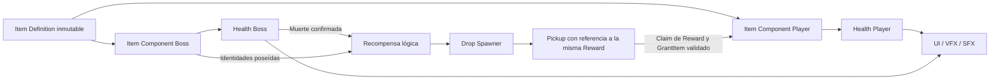

# SoulsNew — análisis y arquitectura inicial propuesta

Fecha: 8 de octubre de 2026 (America/Mexico_City).

**Estado: arquitectura propuesta con Health/modificadores, objetos universales mínimos, recompensas, pickup/spawn automático e integración ThirdPerson con boss de prototipo implementados.** Las secciones de inspección describen el baseline original; las secciones 15–21 concretan los incrementos autorizados posteriormente. ThirdPerson incorpora Health e Items; la sección 21 sustituye la definición transitoria del boss por contenido configurable. Combat, configuración y contenido del template se conservan. Las demás clases siguen siendo propuestas; este documento no autoriza ejecutar todo el roadmap.

## 1. Alcance y evidencia

Se inspeccionaron los 87 archivos de `Source` (42 headers, 42 implementaciones y 3 reglas C#), los 5 `.ini` de `Config`, el descriptor del proyecto, configuración Git/IDE y el inventario completo de `Content`. También se consultaron el recibo local de compilación, el registro del editor y configuración generada de Visual Studio para identificar la versión y el entorno.

El contenido tiene **749 `.uasset` y 4 `.umap`**, 753 archivos en total. Se leyeron cadenas de referencias y metadatos de los Blueprints principales de Third Person, los Blueprints/AI/interactuables, animaciones y UI de Combat, y los cuatro mapas, sin guardarlos ni abrir el editor. Esto aporta evidencia de dependencias, pero **no sustituye una inspección de grafos, defaults serializados, Reference Viewer o comportamiento en PIE**. No se afirma que todos los Blueprints carezcan de lógica crítica ni que sus valores coincidan con los defaults C++.

Las carpetas generadas se inventariaron y se consultaron solo archivos diagnósticos concretos; no se analizó cada caché, PDB o archivo intermedio como arquitectura. No se compiló, ejecutó PIE, cocinó contenido ni corrieron tests en esta revisión. Un binario existente demuestra una compilación anterior, no garantiza que el checkout actual compile ni que todas las variantes funcionen.

`SoulsNew.uproject` declara `EngineAssociation: 5.8`. `Binaries/Win64/SoulsNewEditor.target` declara patch 3 y changelist 58210709; `Saved/Logs/SoulsNew.log` confirma **5.8.3-58210709**. Las rutas generadas ubican el motor en `G:/UE_5.8`. No se modificó ni fue necesario inspeccionar su implementación interna.

## 2. Estructura observada

```text
SoulsNew/
  SoulsNew.uproject
  Source/
    SoulsNew.Target.cs
    SoulsNewEditor.Target.cs
    SoulsNew/
      SoulsNew.Build.cs
      SoulsNew.{h,cpp}
      SoulsNewCharacter.{h,cpp}
      SoulsNewPlayerController.{h,cpp}
      SoulsNewGameMode.{h,cpp}
      Variant_Combat/{AI,Animation,Gameplay,Interfaces,UI,...}
      Variant_Platforming/{Animation,...}
      Variant_SideScrolling/{AI,Gameplay,Interfaces,UI,...}
  Config/                         5 archivos .ini
  Content/                        753 paquetes
  Binaries/, Intermediate/, Saved/, DerivedDataCache/, .vs/
  .git/, .gitignore, .gitattributes, .vsconfig
  SoulsNew.sln, SoulsNew.slnx, Automation_SoulsNew.sln/.slnx
```

No se encontraron carpetas locales `Plugins`, `Build` o `docs` antes de esta tarea, ni un `AGENTS.md` previo en el proyecto o sus directorios ascendentes consultados.

### Compilación y dependencias

- Un único módulo **runtime `SoulsNew`**, cargado en `Default`, con `FDefaultGameModuleImpl` y categoría `LogSoulsNew`.
- Targets `Game` y `Editor`, ambos con `BuildSettingsVersion.V7` e include order `Unreal5_8`.
- Dependencias públicas: `Core`, `CoreUObject`, `Engine`, `InputCore`, `EnhancedInput`, `AIModule`, `StateTreeModule`, `GameplayStateTreeModule`, `UMG`, `Slate`. Dependencias privadas vacías.
- El Build.cs exporta include paths del módulo y todas las variantes. No hay separación actual `Public`/`Private` ni módulos por dominio.
- Plugins explícitos: `ModelingToolsEditorMode` solo Editor, `StateTree` y `GameplayStateTree`. El descriptor no enumera todos los plugins que el motor puede habilitar por defecto.
- No hay implementación propia de atributos compartidos, inventario universal, Data Assets de objetos, Gameplay Tags, GAS, subsistemas de run, SaveGame o replicación de estos sistemas en el C++ inspeccionado. `GameplayTags` y `GameplayAbilities` no figuran como dependencias directas del módulo; no confundir disponibilidad transitiva con un contrato declarado.

### Configuración activa

`DefaultEngine.ini` establece `Lvl_ThirdPerson` como mapa inicial del editor y del juego, y `BP_ThirdPersonGameMode` como GameMode global. Combat no es el modo global activo. Las cadenas de los mapas hacen referencia a sus respectivos GameModes; los overrides efectivos deben confirmarse posteriormente en World Settings.

`DefaultInput.ini` selecciona `EnhancedPlayerInput` y `EnhancedInputComponent`. Las acciones y Mapping Contexts se asignan mediante contenido. El proyecto apunta a escritorio y calidad máxima; configura DX12/SM6, iluminación/reflexión dinámica, sombras virtuales, ray tracing y Substrate. El coste real requiere medición en hardware objetivo.

Hay restos del template: `ProjectName=Third Person Game Template`, rutas de editor `/Game/ThirdPersonCPP` que no corresponden al inventario actual, variables de CommonUI sin dependencia directa declarada, y entradas duplicadas de DX12/autoexposición. Mantener los redirects `TP_ThirdPerson -> SoulsNew` hasta revisar referencias; no limpiarlos por apariencia.

### Inventario de contenido

| Carpeta bajo Content | Archivos | Papel observado |
| --- | ---: | --- |
| `__ExternalActors__` | 479 | Actores externos de los cuatro mapas |
| `__ExternalObjects__` | 42 | Objetos externos asociados a mapas |
| `Characters` | 128 | Manny/Quinn, skeleton, materiales, rigs, animaciones |
| `Input` | 9 | Acciones comunes, IMC y widgets/interfaces táctiles |
| `LevelPrototyping` | 29 | Geometría, materiales, puerta, target y jump pad |
| `ThirdPerson` | 5 | Mapa, material y tres Blueprints principales |
| `Variant_Combat` | 31 | Mapa, BP/AI/EQS/StateTree, montages, UI y VFX |
| `Variant_Platforming` | 11 | Mapa, dash, animación, input y VFX |
| `Variant_SideScrolling` | 19 | Mapa, NPC/StateTree, plataformas, pickup, UI/input |

`Collections` y `Developers` existen como directorios, sin archivos en este inventario. Los cuatro mapas contienen referencias a World Partition y paquetes externos. **Los 521 paquetes externos son contenido, no cachés desechables.**

## 3. Arquitectura C++ existente

### Third Person base

`ASoulsNewCharacter` deriva de `ACharacter`. Proporciona cápsula, CharacterMovement, SpringArm, cámara orbital y movimiento relativo al yaw del controlador. Expone `DoMove`, `DoLook` y salto para entrada/UI. No contiene vida ni combate. El mesh, AnimBlueprint y acciones se configuran en el Blueprint derivado; las referencias legibles de `BP_ThirdPersonCharacter` incluyen Quinn Simple y `ABP_Unarmed`.

`ASoulsNewPlayerController` instala Mapping Contexts para el jugador local y crea controles táctiles cuando corresponde. `ASoulsNewGameMode` es un stub. Estas tres clases son una base más pequeña para el futuro slice que las clases Combat.

### Combat

`ACombatCharacter` y `ACombatEnemy` derivan **por separado de ACharacter**, no de `ASoulsNewCharacter`. Ambos implementan `ICombatAttacker` e `ICombatDamageable`, pero duplican vida, trazas, daño, combos y reacción física. Player tiene `MaxHP=5`; Enemy `MaxHP=3` como defaults C++. No son los valores efectivos necesariamente usados por sus Blueprints.

Player incluye input cache, combo, ataque cargado, cámara lateral, WidgetComponent de vida, ragdoll, muerte y timer de respawn. Enemy incluye combos aleatorios, carga por loops, aviso de peligro, muerte con delegate y retirada temporizada. `ApplyHealing` está sin implementar en ambos.

`ACombatPlayerController` escucha la destrucción del pawn y lo recrea en el checkpoint. `ACombatGameMode` crea jugadores locales adicionales y elige PlayerStarts con actor tags `PlayerN`. No existe ciclo roguelike ni persistencia del inventario al recrear el pawn.

La AI usa `ACombatAIController` + `UStateTreeAIComponent`, tareas/condiciones C++, EQS y `ST_CombatEnemy`. Las tareas solicitan ataques y esperan delegates; se usa contexto débil para completarlas y se desuscriben al salir. Es una referencia útil, aunque varias tareas dependen directamente de `ACombatEnemy`. EQS Player consulta el jugador local 0 y exige su existencia mediante `check`.

`ACombatEnemySpawner` genera enemigos uno por uno, escucha su muerte, agenda el siguiente y activa actores al agotarse. No elige objetos ni recompensas. ActivationVolume, CheckpointVolume, DamageableBox, Dummy y LavaFloor son ejemplos de interacción/daño del template. El Dummy reacciona físicamente y no tiene vida ni muerte funcional.

`AnimNotify_DoAttackTrace`, `AnimNotify_CheckCombo` y `AnimNotify_CheckChargedAttack` llaman a la interfaz del owner. Los montages serializados referencian esos notifies. `UCombatLifeBar` expone eventos de presentación Blueprint. Existen hooks C++ para efectos de daño y cámara.

### Platforming y SideScrolling

Platforming incluye salto mantenido, doble salto, wall jump, coyote time y dash con montage, eliminación temporal de gravedad y notify de finalización. Su dash **no es una esquiva Soulslike**: no incorpora stamina, invulnerabilidad, perfect dodge o reglas de combate.

SideScrolling fija movimiento a un plano y cámara lateral; añade plataformas blandas/móviles, interacción, jump pad, NPC con StateTree y UI de coleccionables. `ASideScrollingPickup` acepta un Character controlado por jugador y llama `ASideScrollingGameMode::ProcessPickup`, que incrementa un contador. No posee una definición universal, inventario ni efectos; no sirve como implementación del sistema de objetos.

## 4. Decisiones iniciales propuestas

### Un módulo y composición compartida

Mantener `SoulsNew` como módulo único durante los primeros incrementos y separar carpetas/responsabilidades. No construir ahora un framework genérico, múltiples módulos o un sistema completo de habilidades.

La entidad compatible es un `AActor` con los componentes/capacidades requeridos, expuestos por un contrato pequeño `ISoulsItemOwner`. No necesita ser Player ni heredar de un Character común. Player, Boss, Elite Enemy, Miniboss y Companion usarán las mismas APIs de vida y posesión.

### Núcleo pequeño; decisión GAS antes de ampliar combate

Para el slice de Vitalidad propongo componentes C++ pequeños y un registro de modificadores reversible. **No habilitar GAS en esta tarea.** GAS ofrece componentes de habilidades, atributos y efectos, por lo que merece una evaluación antes de implementar habilidades/status effects extensos. Véase la [documentación oficial de GAS](https://dev.epicgames.com/documentation/unreal-engine/gameplay-ability-system-for-unreal-engine?lang=en-US).

| Opción | Ventaja para SoulsNew | Coste/decisión |
| --- | --- | --- |
| Componentes propios mínimos | Slice acotado y contratos claros | Implementar/probar agregación y ciclo de vida; no evolucionar accidentalmente a un clon de GAS |
| GAS de Epic | Base existente para atributos, habilidades y efectos | Integración, aprendizaje y dependencias `GameplayAbilities`/`GameplayTasks`/`GameplayTags`; cambia diseño de atributos y ejecución |

Si se elige GAS posteriormente, migrar la autoridad de atributos/efectos a ASC/AttributeSet y mantener identidad, inventario, compatibilidad y loot como dominio del juego. No mantener simultáneamente un `MaxHealth` propio y otro de GAS. Las interfaces reducen acoplamiento, pero no eliminan el coste de migración. Multiplayer/predicción o muchos efectos temporales pueden justificar elegir GAS antes del primer slice; esos requisitos aún no están definidos.

### Gameplay Tags y assets de datos

Recomiendo declarar `GameplayTags` como dependencia directa en el primer incremento que los use: aporta vocabulario jerárquico y queries de requisitos, sin requerir GAS. Los `Actor Tags` FName del template no son Gameplay Tags. Los tags deben registrarse en un diccionario controlado; la jerarquía y las queries se describen en [Gameplay Tags de Epic](https://dev.epicgames.com/documentation/en-us/unreal-engine/using-gameplay-tags-in-unreal-engine).

Propongo `USoulsItemDefinition : UPrimaryDataAsset` para la definición única. Asset Manager permite identificar y descubrir Primary Assets; al autorizar la implementación habrá que configurar scan/cook y referencias blandas. No hace falta crear un AssetManager propio si el estándar cubre el caso. Referencia: [Asset Management de Epic](https://dev.epicgames.com/documentation/en-us/unreal-engine/asset-management-in-unreal-engine).

## 5. Responsabilidades y fronteras

Los nombres de esta tabla siguen siendo **propuestos**, excepto `USoulsHealthComponent` y `FSoulsAttributeModifier` (sección 15), `USoulsItemComponent`, `USoulsItemDefinition` y `FSoulsOwnedItem` (sección 16), `USoulsRewardComponent` y `USoulsItemReward` (sección 17), `ASoulsItemPickup` (sección 18) y `USoulsRewardDropSpawnerComponent` (sección 19). Las tres clases base de SoulsNew ya existían.

| Elemento | Responsabilidad | Cuándo |
| --- | --- | --- |
| `USoulsHealthComponent` | BaseMaxHealth, máximo efectivo, vida actual, daño mínimo, estado de muerte; notificaciones | Slice |
| `USoulsItemComponent` | Posesiones por owner, validación, grant/remove, handles y activación de pasivos | Slice |
| `USoulsItemDefinition` | Datos inmutables de identidad, reglas y presentación | Slice, schema mínimo |
| `FSoulsOwnedItem` | Referencia/ID de definición, handle de posesión y estado del owner | Slice |
| `FSoulsAttributeModifier` / handle | Contribución identificada sobre un atributo, fuente y operación | Slice, solo MaxHealth |
| `ISoulsItemOwner` | Acceso a posesión/capacidades sin cast a Player/Boss | Slice |
| `ASoulsItemPickup` | Retener Reward, overlap con Actor compatible, Claim y consumo físico tras éxito | Implementado, aislado |
| `USoulsRewardComponent` | Escuchar muerte y capturar definición de un grant seleccionado, una vez por ciclo | Implementado, selección explícita |
| `USoulsItemReward` | RewardId, referencia a definición, Available/Claimed y claim mediante GrantItem | Implementado, recompensa lógica |
| `USoulsRewardDropSpawnerComponent` | Escuchar RewardGenerated, materializar la misma Reward en un pickup y conservar pendientes para retry explícito | Implementado, Actors genéricos |
| `ASoulsBossCharacter` | Cuerpo/presentación del boss; compone vida y objetos | Slice, boss inerte |
| `ASoulsPrototypeBoss` | Actor inerte de prueba con vida, ItemDefinition configurable, recompensa y drop universales | Implementado, prototipo; no sustituye al boss definitivo |
| `USoulsCombatEventComponent` | Eventos locales tipados; suscripción por trigger | Después del slice; muerte puede usar delegate de Health inicialmente |
| `USoulsCombatComponent` | Pipeline de ataques/daño, estado, costes, defensa y ventanas | Incrementos posteriores |
| `USoulsStatusEffectComponent` | Duraciones, periodicidad, refresh y limpieza | Solo cuando existan efectos temporales |
| `USoulsBossLoadoutDefinition` | Pool, pesos y restricciones de asignación de tres | Después del slice |
| `USoulsRunSubsystem : UGameInstanceSubsystem` | Semilla, estado de run y restauración entre mapas | Al introducir runs |

PlayerController traduce entrada; AIController/StateTree decide qué acción solicitar; ambos llaman las mismas APIs de combate. GameMode dirige el encuentro y sus fases. UI y animación observan estado y solicitan acciones validadas. No hacer al RunSubsystem propietario de todos los componentes del mundo.



Dirección de dependencias: Items utiliza contratos de capacidades, atributos y eventos; Health no conoce Vitalidad ni reglas de loot. RewardComponent conoce posesiones y muerte; ItemReward concede mediante Items. DropSpawner adapta RewardGenerated al spawn físico; Pickup retiene ItemReward y solicita Claim hacia un ItemComponent. Ningún componente depende del widget para funcionar.

## 6. Modelo universal de objetos

### Definición versus estado

| Capa | Datos | No debe contener |
| --- | --- | --- |
| Definición | ID, nombre/icono, ItemTags/categoría, requisitos, ExclusiveGroups, bloqueos, reglas, VFX/SFX | Owner, stacks actuales, cooldowns, timers |
| Posesión por owner | DefinitionId/ref, handle, stack count, registro de concesión y estado de triggers | Copia mutada de la definición |
| Efecto activo | Fuente/handle, objetivo/atributo, operación, magnitud y eventual expiración | Una versión Player/Boss de la regla |
| Recompensa lógica | RewardId, misma referencia de definición, Available/Claimed, GrantId concedido al reclamar | Dependencia del Actor/grant/modificadores de origen |
| Pickup | Referencia a Reward, guard de interacción y consumo físico | Copia de definición/recompensa o puntero necesario al boss muerto |

Empezar con structs reflejados para posesión/modificadores. Añadir UObjects de ejecución por efecto solo cuando necesiten polimorfismo o estado complejo. Toda referencia persistente debe tener un ID estable; `FPrimaryAssetId` requiere redirects/migración si se renombra un asset. Los assets retenidos en runtime deben estar protegidos de GC/carga descargada mediante ownership reflejado o handles de carga apropiados.

### Reglas data-driven

Schema conceptual de una regla:

```text
Trigger: OnAcquire / WhileOwned / evento tipado
Conditions: query de tags + condiciones C++ reutilizables sobre el contexto
Effects: lista de primitivas C++ y parámetros (atributo, operación, magnitud)
Duration: Instant / WhileOwned / Timed (Timed y periodicidad se difieren)
StackRules: por definición/owner, límite, refresh y acumulación
Presentation: referencias blandas a VFX, SFX, icono y texto
```

Un pasivo WhileOwned se instala al adquirir y se retira al perder el objeto; no se reaplica cada Tick. Una regla reactiva se suscribe al evento, evalúa condiciones y ejecuta efectos a través del servicio correspondiente. Para Vitalidad solo se necesita un modificador pasivo de MaxHealth; no implementar ahora un editor visual de reglas ni todas las primitivas.

Vitalidad se configurará una sola vez, conceptualmente en `DA_Item_Vitalidad`:

```text
Identidad: Vitalidad
Requisito: Capability.Health
Regla: WhileOwned
Efecto: atributo MaxHealth, operación AdditivePercent, magnitud 0.25
Duración: WhileOwned
Stack: pendiente; la segunda fase técnica permite grants independientes
ExclusiveGroups: ninguno
```

Esto es documentación, no un asset creado. El nombre Vitalidad no aparece en ramas de lógica del Character.

### Atributos y stacking

Para el primer incremento, el registro de contribuciones vive dentro de Health; no crear aún un componente independiente para docenas de atributos vacíos. Si crecen los atributos, extraer un agregador compartido conservando sus handles/API. Stamina/Poise tendrán sus reglas de recursos, sin reutilizar callbacks de muerte de Health.

Regla concretada en la primera fase de Health, siguiendo el orden solicitado para Flat, AdditivePercent y Multiplicative:

```text
MaxHealth = max(MinimumMaxHealth,
                (BaseMaxHealth + Sum(FlatModifiers))
                * (1 + Sum(AdditivePercentModifiers))
                * Product(MultiplicativeModifiers))
```

Para el futuro ejemplo de Vitalidad no hay flat modifiers: `500 * 1.25 = 625`; `100 * 1.25 = 125`. La capa porcentual amplifica ahora base y bonos planos, en lugar de la propuesta original de porcentaje sobre base únicamente: se adopta el orden solicitado en la tarea de implementación. Dos contribuciones de +25% suman +50% en esta capa. Multiplicative usa factores, por ejemplo 1.25, cuyo producto se aplica al final; su identidad es 1. El mínimo efectivo es 1 HP. No hay overrides ni prioridades implícitas.

La política final de duplicados sigue pendiente. En la segunda fase técnica, otorgar la misma definición dos veces crea dos grants con contribuciones independientes (+50% aditivo en este ejemplo). Quitar un grant elimina solo sus handles y recalcula desde base y contribuciones restantes, sin dividir un valor acumulado por 1.25. Cambiar BaseMaxHealth también recalcula usando la misma regla. Esta decisión técnica del incremento autorizado sustituye la propuesta inicial UniquePerOwner; no fija stacking, niveles ni evolución del diseño final.

**Política implementada: PreservePercentage.** Al modificar MaxHealth mientras está vivo, preservar la proporción (`newCurrent = oldCurrent / oldMax * newMax`, limitada al nuevo rango). El componente nace lleno y su inicialización reconcilia la base configurada conservando esa proporción. Así las pruebas de base 500 y 100 terminan en `625/625` y `125/125`; `50/100` pasa a `62.5/125`. También se aplica al quitar modificadores y cambiar la base. Un muerto permanece en 0 y nunca revive por recalcular atributos o por Heal; solo el reinicio C++ explícito de ciclo lo permite. Una política distinta requerirá cambiar esta función y sus tests, sin modificar directamente CurrentHealth desde Blueprint.

### Transacciones y ciclo de vida

Grant: resolver definición -> comprobar owner y compatibilidad -> preparar contribuciones/suscripciones -> registrar posesión y activar -> confirmar -> notificar. Si algo falla, revertir lo preparado. Remove: retirar exclusivamente handles/timers/suscripciones de la posesión -> borrar registro -> notificar. La misma función se usa para boss, jugador y otras entidades.

Duplicados de notificaciones no son adquisiciones nuevas: usar handle/token para idempotencia. No serializar delegates, punteros a actores destruidos o handles temporales como progreso guardado. En el futuro se guardarán IDs, stacks y datos necesarios; la carga reconstruirá efectos sin duplicarlos.

## 7. Compatibilidad y asignación del boss

### Vocabulario propuesto

- Capacidades: `Capability.Health`, `Capability.Dodge`, `Capability.Parry`, `Capability.Melee`.
- Categorías: `Item.Category.Defense`, `Item.Category.Offense`, `Item.Category.Utility`.
- Estado: `State.Dead`, `State.Attacking`, `State.Dodging`, `State.Parrying`.
- Exclusión: `Item.Exclusive.DodgeReplacement` para objetos que reemplazan la esquiva.

Los nombres se documentarán/registrarán como contrato; categorías no implican exclusión. Un objeto puede reservar varios grupos. Definir matching exacto o jerárquico por campo: grupos exclusivos inicialmente por igualdad exacta; requisitos/bloqueos mediante queries explícitas. Cambios de jerarquía de tags pueden cambiar compatibilidad y requieren validación de datos.

`CanAcquire` valida:

1. Definición válida, estado del receptor y capacidades reales. Los tags de capacidad no deben mentir sobre componentes disponibles.
2. RequiredOwnerQuery y BlockedOwnerQuery; no bloquear Vitalidad por `Owner.Player`/`Owner.Boss`.
3. Política de duplicados/stacks.
4. Colisiones de ExclusiveGroups con todas las posesiones.
5. Requisitos del inventario y conflictos **en ambas direcciones**: los bloqueos de A hacia B y de B hacia A.
6. Si el candidato aporta capacidades/tags, validar también que el conjunto resultante conserve los requisitos de los objetos existentes. En la primera versión, limitar requisitos a capacidades estables del owner para evitar ciclos entre objetos.

Dos reemplazos de esquiva distintos reservan `DodgeReplacement` y no coexisten. La habilidad base es el fallback del sistema de acciones; retirar el reemplazo restaura ese fallback. Esta resolución debe vivir en C++ cuando se implemente Dodge, sin dos objetos sobrescribiendo una referencia en Blueprint.

### Tres objetos aleatorios compatibles

La selección debe trabajar sobre un catálogo explícito y pesos validados, con semilla de run/encuentro y candidatos ordenados establemente por ID. Filtrar primero incompatibilidades con owner y luego construir un conjunto de **tres diferentes**. Una búsqueda finita con backtracking permite resolver conflictos entre candidatos y no descartar un trío existente por una primera elección greedy desafortunada.

Definir la política de ponderación antes de producción: una exploración en orden aleatorio ponderado no garantiza distribución uniforme sobre todos los tríos válidos. El primer incremento de tres puede usar un catálogo pequeño y elegir entre tríos válidos enumerados; para un catálogo grande será necesario un algoritmo y presupuesto de búsqueda documentados. Agotar ese presupuesto es un fallo de búsqueda, no una prueba de que no existe trío.

Si no se puede formar/activar el conjunto, devolver error con causas; el boss sigue sin activar combate. No completar con duplicados, objetos incompatibles ni pasivos que solo aparecen visualmente. Validar pools en edición y en runtime porque capacidades/inventario pueden cambiar.

### Inicialización y muerte

No confiar en el orden entre BeginPlay de componentes y OnPossess de AI. Flujo explícito para actor colocado o generado:

```text
Creado/inactivo
 -> establecer atributos base y capacidades
 -> resolver datos y loadout
 -> conceder objetos mediante la API universal
 -> recalcular atributos y establecer vida inicial llena
 -> registrar snapshot de recompensa y oyentes de muerte
 -> marcar Ready
 -> habilitar daño/input/AI del encuentro
```

Si se usa spawn diferido, complementarlo con ese gate Ready; no asumir que por sí solo resuelve toda inicialización. La selección de recompensa usa el snapshot/posesiones del encuentro antes de la limpieza de efectos. Para el modelo inicial, el loadout del boss permanece fijo durante el encuentro; objetos temporales generados por procs no entran accidentalmente en su pool de recompensa.

Muerte confirmada -> marcar transición una sola vez -> seleccionar uniformemente uno de los tres IDs del encuentro -> generar un pickup con ese ID -> confirmar token de recompensa -> limpiar efectos/AI -> presentación/retirada del cadáver. Si el spawn del pickup falla, conservar la recompensa pendiente y el mismo ID para reintento controlado; no marcarla entregada ni volver a sortear por cada intento.

La posesión del jugador es nueva: mantiene definición y mecánica, pero no hereda punteros, cooldowns, vida o timers del cadáver. Si más adelante un objeto tiene parámetros aleatorios que cambian su mecánica, esos parámetros del ejemplar deben viajar en la recompensa; no rerollearlos al recoger.

Pickup: verificar compatibilidad -> reservar transacción -> otorgar -> consumir. Un objeto incompatible o ya poseído bajo UniquePerOwner permanece disponible y explica la razón; no se destruye ni reemplaza otro silenciosamente. La política de duplicados monetizables/recompensas alternativas queda pendiente.

## 8. Combate y eventos futuros

Usar un flujo C++ único: solicitud -> validación de estado/costes -> ventana de acción -> detección -> resolución defensiva -> daño/poise aplicado -> transición de vida -> eventos confirmados -> presentación. Los notifies pueden señalar ventanas, pero el estado C++ acepta/rechaza e identifica la acción.

Contexto conceptual de evento: tipo/tag, EventId/CauseId, instigador, receptor, actor origen, item/effect fuente cuando aplique, ataque/acción, magnitud solicitada y realmente aplicada, impacto, tags/resultados y tiempo. Referencias a actores en contextos diferidos deben ser débiles o snapshots. No crear ahora todos estos campos ni el bus completo para un pasivo.

| Evento | Emisor/semántica propuesta |
| --- | --- |
| OnHit | Instigador; contacto válido resuelto. Payload diferencia hit bloqueado, parry y daño positivo |
| OnDamageReceived | Receptor; reducción de vida positiva confirmada, magnitud efectiva limitada a la vida perdida |
| OnDodge / OnPerfectDodge | Owner; Dodge al iniciar acción válida; PerfectDodge cuando una amenaza real evitada cumple la ventana, una vez por amenaza |
| OnParry / OnPerfectParry | Defensor; ataque realmente interceptado, Perfect solo dentro de ventana definida |
| OnKill | Instigador acreditado; una vez al confirmar muerte del objetivo; daño ambiental puede no tener killer |
| OnDeath | Receptor; única transición Alive -> Dead, antes de invalidar contexto/recompensa |
| OnLowHealth | Owner; entrada al umbral, con histéresis/rearme. No emitir cada Tick mientras está bajo |

Normal y perfecto deben tener relación explícita: un resultado perfecto también puede tener la categoría normal en su payload, pero una regla que escucha ambos no debe dispararse dos veces por la misma acción. Definir fases para low health, muerte y kill; una muerte no debe provocar un proc de low health que reanime implícitamente al receptor.

Antes de objetos reactivos, introducir protección de reentrada: IDs causales, política para eventos originados por procs, máximo de profundidad/presupuesto y cola de mutaciones de inventario. Evitar bucles como OnHit -> daño extra -> OnHit -> daño extra. Los modificadores previos al daño usan una fase de resolución controlada, no un observer de daño confirmado que reescribe el pasado.

## 9. Riesgos técnicos detectados

| Riesgo/evidencia | Consecuencia | Tratamiento propuesto |
| --- | --- | --- |
| Vida/trazas/ataques duplicados en CombatCharacter y CombatEnemy | Mecánicas Player/Boss divergen; objetos aplicados en un solo lado | Núcleo común por componentes; no copiar la variante al nuevo boss |
| Vida/UI/ragdoll juntas; `check(LifeBarWidget)` y desreferencias en ambos personajes | La ausencia de widget puede impedir iniciar gameplay | Vida independiente; presentación opcional |
| `MaxHP` de CombatCharacter tiene ClampMax 100 en editor | Restricción inapropiada para vida modificada/bosses | Nuevo atributo sin ese límite arbitrario; clamps de recursos en C++ |
| `TakeDamage` resta daño bruto, sin clamp de entrada/HP; devuelve cantidad solicitada | Vida negativa/curación por daño negativo y procs con magnitud incorrecta | Validar finitud/no negatividad y devolver daño realmente aplicado |
| `HandleDeath` expuesto vía interfaz, sin guard interno propio | Llamadas directas repetidas pueden repetir callbacks | Transición idempotente en Health y token de recompensa |
| Montages: se establece `bIsAttacking` antes de validar reproducción; dash pone gravedad 0 antes de reproducir | Datos faltantes pueden dejar ataques/dash atascados | Validar assets y limpiar estados por fallo/interrupción/EndPlay |
| `RandRange(1, ComboSectionNames.Num()-1)` en enemigo | Configuración vacía/pequeña no validada | Validación de datos y failure paths; no importar sin revisión |
| Sweeps recorren hits sin deduplicación por actor/AttackId | Posibles impactos/procs múltiples sobre un objetivo | Set de objetivos por ventana/ataque; política multihit explícita |
| Enemy usa actor tag `Player`; EQS consulta player 0; tareas castean CombatEnemy | Dificulta compañeros, facciones y objetivos universales | Capacidades/relaciones de equipo y contratos; aplazar AI compleja |
| Respawn por OnDestroyed recrea pawn; muerte/retirada limpia estado | Pérdida de objetos o respawn durante limpieza si se reutiliza sin cambios | Distinguir derrota, fin de run y teardown; persistencia cuando se diseñe |
| Spawner escucha la muerte después de SpawnActor | Inicialización dentro de BeginPlay puede ocurrir antes del listener | Gate Ready y oyentes antes de permitir daño |
| Definición compartida mutada, grant repetido o retirada sin handle | Boss afecta datos del player; porcentajes acumulados/efectos huérfanos | Data Asset inmutable, estado por owner y contribuciones identificadas |
| Selección greedy o catálogo insuficiente | Boss con menos de tres o combinación inválida | Solver finito, validación de pools y resultado fallido explícito |
| Objetos ilimitados con Tick o búsquedas globales por objeto | Coste escala con inventario y enemigos | Pasivos agregados y dispatch por trigger; medir catálogo representativo |
| Soft refs sin scan/cook del catálogo | Funciona en editor y faltan objetos en build | Asset Manager y smoke test empaquetado |
| World Partition y 521 paquetes externos | Borrado/movimiento manual rompe mapas/referencias | Gestionar con herramientas del editor y dependencias revisadas |
| DX12/SM6, ray tracing, Substrate y calidad máxima | Coste/compatibilidad del hardware aún desconocidos | Fijar hardware objetivo y perfilar; no optimizar prematuramente |
| Rutas/editor/nombre residual y entradas duplicadas en Config | Confusión de mapas/configuración | Limpieza puntual futura, conservando redirects necesarios |
| Todo en dependencias públicas e includes globales de variantes | Acoplamiento y coste de compilación | Nuevas áreas con includes explícitos; revisar Public/Private sin mover todo ahora |
| Sin pruebas propias de contratos; logs muestran `LogAutomationTest: Error: Condition failed` en inicio | Baseline no acreditado como sano | Investigar origen en fase de verificación; el extracto no atribuye esos errores al gameplay |

`.gitignore` excluye correctamente carpetas generadas y soluciones. `.gitattributes` asigna LFS a `.uasset`/`.umap`. La consulta `git lfs ls-files` falló por acceso a `.git` en este entorno; **no se verificó la operatividad de LFS, su tracking efectivo ni disponibilidad remota**. Verificar un checkout/cook reproducible antes de colaboración con assets. No cambiar Git ni LFS en esta tarea.

## 10. Qué reutilizar y qué dejar fuera

| Parte actual | Decisión propuesta |
| --- | --- |
| SoulsNewCharacter + PlayerController | Base de locomoción/cámara/Enhanced Input; añadir componentes en un incremento posterior |
| ThirdPerson GameMode y mapa | Referencia funcional; preferir un mapa de prueba nuevo y pequeño para el slice cuando se autorice |
| Manny/Quinn, skeleton, rigs, ABP_Unarmed, BS_Idle_Walk_Run | Representación provisional; confirmar skeleton y grafos antes de reutilizar |
| LevelPrototyping | Graybox de arena y representación temporal del pickup |
| AM_ComboAttack / AM_ChargedAttack y notifies C++ | Referencia de timing/interfaces, no autoridad final de daño ni diseño Soulslike |
| CombatLifeBar / UI_LifeBar / NS_Damage / CameraShake | Presentación provisional desacoplada, sin arrastrar dependencia UI -> vida |
| Combat StateTree/EQS/spawner | Referencia para futuros enemigos; no necesarios para el boss inerte del slice |
| Interfaces Combat/SideScrolling | Referencia de separación de contratos; no asumir que cubren items ni requisitos nuevos |
| Platforming dash | Referencia de animación/movimiento; no reutilizar como Dodge definitivo |
| SideScrollingPickup | Referencia de overlap/feedback; reemplazar el grant basado en GameMode/contador en el sistema nuevo |

Ignorar en el primer slice: split screen/local multiplayer, touch UI si la plataforma objetivo es PC, wall jump/doble salto, cámara lateral, plataformas blandas/móviles, armas Pistol/Rifle, lava/checkpoints y AI de combate compleja. Mantenerlos por ahora.

Candidatos a retirar posteriormente: mapas y clases de Platforming/SideScrolling, contenido Pistol/Rifle no usado, input/UI táctil si queda fuera de las plataformas, y clases Combat cuando sus referencias útiles hayan sido migradas. **No hay eliminación autorizada ni prueba de que sean assets huérfanos.** Antes de retirarlos: revisar Reference Viewer, referencias nativas/soft refs, mapas, cook, redirects y validar PIE/build. No quitar StateTree/GameplayStateTree mientras el módulo compile fuentes que los requieren.

## 11. Organización futura sugerida

```text
Source/SoulsNew/
  Core/          contratos y vocabulario de tags/contextos
  Characters/    composición de player/boss/enemy
  Attributes/    Health y modificadores; más recursos cuando se necesiten
  Items/         definición, posesión, compatibilidad y primitivas
  Interaction/   pickup y recogida
  Combat/        acciones, eventos, ventanas y resolución (posterior)
  AI/            decisiones y adaptadores de StateTree (posterior)
  Run/           estado/semilla/progresión de run (posterior)
  UI/            puentes de presentación
  Tests/         contratos que requieren validación
Content/SoulsNew/
  Items/Definitions/
  Characters/{Player,Bosses,Enemies}/
  Blueprints/
  Input/
  UI/
  Maps/Tests/
```

Crear solo áreas con implementación real. El contenido del template conserva sus rutas durante la transición. Adoptar `Public`/`Private` para nuevas fronteras exportadas cuando proceda; no reorganizar hoy el módulo ni los assets existentes.

## 12. Roadmap incremental y criterios de salida

| Fase | Entrega acotada | Verificación/criterio de salida |
| --- | --- | --- |
| 0 — esta tarea | Análisis, AGENTS.md y esta propuesta | Solo documentación; archivos existentes preservados |
| 1 — baseline y contrato | Confirmar build Editor 5.8.3, abrir ThirdPerson/Combat en PIE sin guardar cambios accidentales, resolver origen de errores de log; fijar política de vida actual y decisión de backend | Baseline reproducible; alcance del slice y dependencias explicados |
| 2 — Health mínimo | Componente con base/máximo/actual, daño controlado, modificadores con handles y muerte única; owner Player 100 y Boss 500 | Pruebas de daño/clamp/recalculo/retirada y UI opcional; sin stamina/poise |
| 3 — objeto universal mínimo | Definición + ItemComponent + requisito real Health; grants técnicos independientes (incremento implementado en sección 16) | La misma referencia produce 625 y 125; retirada individual, aislamiento y transacciones probados; política final de duplicados pendiente |
| 4 — cerrar primer vertical slice | Boss inerte con Vitalidad, muerte por daño de prueba autorizado, recompensa única y pickup | Flujo completo 500 -> 625 -> muerte -> pickup -> 100 -> 125; recolección y muerte repetidas no duplican efectos/drop |
| 5 — tres objetos compatibles | Catálogo pequeño adicional, tags/grupos/bloqueos, semilla y selección de tres | Los tres efectos existen en runtime; drop pertenece al trío; pool insuficiente y combinaciones bloqueadas devuelven fallo |
| 6 — combate básico | Daño/hit/eventos confirmados, Light Attack y enemigo mínimo; después Heavy/Charged, stamina y Dodge | Sin dobles hits/procs; mismas APIs desde player y AI; interrupciones/costes consistentes |
| 7 — defensa y efectos reactivos | Perfect Dodge, Parry/Perfect Parry, Poise/Stagger, status effects y triggers por incrementos separados | Ventanas/causalidad/stack/duración y limpieza probadas; decisión GAS resuelta antes de esta expansión |
| 8 — loop roguelike | Estado/semilla de run, progreso de encuentros, persistencia y reset de inventario según diseño | Nueva run no arrastra efectos; transiciones/restauración coherentes; smoke test empaquetado |

Las fases 2–4 forman un único slice jugable mínimo con incrementos revisables. La fase 3 puede usar fixtures de prueba para demostrar ambos owners; la adquisición del jugador dentro del flujo jugable ocurre mediante el drop de fase 4.

**Primero:** Health + modificadores, definición/posesión universal, muerte/drop y recogida. Usar daño de prueba mediante API para matar al boss; no construir ataques completos ni AI para demostrar Vitalidad. No implementar los tres objetos aleatorios en el slice: el loadout de prueba tiene uno, con excepción explícita y separada de la regla de producción.

Pruebas futuras mínimas del slice:

- Boss sin objeto `500/500`; con Vitalidad `625/625` y un solo handle.
- Player sin objeto `100/100`; tras recoger la misma definición `125/125` bajo la política propuesta.
- Un actor compatible adicional obtiene el mismo porcentaje; uno sin Health rechaza sin efectos parciales.
- Retirada vuelve al máximo base; reequipar no produce deriva; cambiar base recalcula.
- Retirar dos veces el mismo grant no duplica operaciones; la política de duplicados de adquisición queda pendiente. Doble overlap no duplica una recogida; adquisición rechazada no consume el pickup.
- Muerte una sola vez; Destroy por limpieza no da loot; el pickup conserva datos aunque se destruya el cadáver.
- Fallo al crear pickup no pierde la recompensa ni cambia el sorteo.
- Repetir en PIE y en build empaquetada al configurar catálogo/cook.

## 13. Decisiones pendientes antes de escalar

Fijar plataforma/hardware objetivo, single player o multiplayer, adquisición de objetos duplicados, overrides/prioridades de atributos si se necesitan, conservación de objetos al morir/cambiar mapa, meta-progresión entre runs y posible GAS antes de escalar combate. PreservePercentage y las tres capas de cálculo ya quedaron concretadas en la primera fase de Health. No implementar soluciones a las demás preguntas sin el incremento correspondiente.

## 14. Archivos existentes inspeccionados

### Lectura de fuente y configuración

En la lista siguiente, `{h,cpp}` significa que se inspeccionaron ambos archivos. Las entradas suman los 42 pares y las 3 reglas C# actuales.

```text
SoulsNew.uproject
.gitignore
.gitattributes
.vsconfig
Config/DefaultEditor.ini
Config/DefaultEditorPerProjectUserSettings.ini
Config/DefaultEngine.ini
Config/DefaultGame.ini
Config/DefaultInput.ini
Source/SoulsNew.Target.cs
Source/SoulsNewEditor.Target.cs
Source/SoulsNew/SoulsNew.Build.cs
Source/SoulsNew/SoulsNew.{h,cpp}
Source/SoulsNew/SoulsNewCharacter.{h,cpp}
Source/SoulsNew/SoulsNewGameMode.{h,cpp}
Source/SoulsNew/SoulsNewPlayerController.{h,cpp}
Source/SoulsNew/Variant_Combat/CombatCharacter.{h,cpp}
Source/SoulsNew/Variant_Combat/CombatGameMode.{h,cpp}
Source/SoulsNew/Variant_Combat/CombatPlayerController.{h,cpp}
Source/SoulsNew/Variant_Combat/AI/CombatAIController.{h,cpp}
Source/SoulsNew/Variant_Combat/AI/CombatEnemy.{h,cpp}
Source/SoulsNew/Variant_Combat/AI/CombatEnemySpawner.{h,cpp}
Source/SoulsNew/Variant_Combat/AI/CombatStateTreeUtility.{h,cpp}
Source/SoulsNew/Variant_Combat/AI/EnvQueryContext_Danger.{h,cpp}
Source/SoulsNew/Variant_Combat/AI/EnvQueryContext_Player.{h,cpp}
Source/SoulsNew/Variant_Combat/Animation/AnimNotify_CheckChargedAttack.{h,cpp}
Source/SoulsNew/Variant_Combat/Animation/AnimNotify_CheckCombo.{h,cpp}
Source/SoulsNew/Variant_Combat/Animation/AnimNotify_DoAttackTrace.{h,cpp}
Source/SoulsNew/Variant_Combat/Gameplay/CombatActivationVolume.{h,cpp}
Source/SoulsNew/Variant_Combat/Gameplay/CombatCheckpointVolume.{h,cpp}
Source/SoulsNew/Variant_Combat/Gameplay/CombatDamageableBox.{h,cpp}
Source/SoulsNew/Variant_Combat/Gameplay/CombatDummy.{h,cpp}
Source/SoulsNew/Variant_Combat/Gameplay/CombatLavaFloor.{h,cpp}
Source/SoulsNew/Variant_Combat/Interfaces/CombatActivatable.{h,cpp}
Source/SoulsNew/Variant_Combat/Interfaces/CombatAttacker.{h,cpp}
Source/SoulsNew/Variant_Combat/Interfaces/CombatDamageable.{h,cpp}
Source/SoulsNew/Variant_Combat/UI/CombatLifeBar.{h,cpp}
Source/SoulsNew/Variant_Platforming/PlatformingCharacter.{h,cpp}
Source/SoulsNew/Variant_Platforming/PlatformingGameMode.{h,cpp}
Source/SoulsNew/Variant_Platforming/PlatformingPlayerController.{h,cpp}
Source/SoulsNew/Variant_Platforming/Animation/AnimNotify_EndDash.{h,cpp}
Source/SoulsNew/Variant_SideScrolling/SideScrollingCameraManager.{h,cpp}
Source/SoulsNew/Variant_SideScrolling/SideScrollingCharacter.{h,cpp}
Source/SoulsNew/Variant_SideScrolling/SideScrollingGameMode.{h,cpp}
Source/SoulsNew/Variant_SideScrolling/SideScrollingPlayerController.{h,cpp}
Source/SoulsNew/Variant_SideScrolling/AI/SideScrollingAIController.{h,cpp}
Source/SoulsNew/Variant_SideScrolling/AI/SideScrollingNPC.{h,cpp}
Source/SoulsNew/Variant_SideScrolling/AI/SideScrollingStateTreeUtility.{h,cpp}
Source/SoulsNew/Variant_SideScrolling/Gameplay/SideScrollingJumpPad.{h,cpp}
Source/SoulsNew/Variant_SideScrolling/Gameplay/SideScrollingMovingPlatform.{h,cpp}
Source/SoulsNew/Variant_SideScrolling/Gameplay/SideScrollingPickup.{h,cpp}
Source/SoulsNew/Variant_SideScrolling/Gameplay/SideScrollingSoftPlatform.{h,cpp}
Source/SoulsNew/Variant_SideScrolling/Interfaces/SideScrollingInteractable.{h,cpp}
Source/SoulsNew/Variant_SideScrolling/UI/SideScrollingUI.{h,cpp}
```

### Lectura parcial de diagnóstico y metadatos binarios

- `Binaries/Win64/SoulsNewEditor.target`: cabecera/version, no auditoría de todas sus dependencias de motor.
- `Saved/Logs/SoulsNew.log`: versión, diagnósticos y contexto alrededor de errores de inicialización; sin atribuir causa no comprobada.
- `Intermediate/ProjectFiles/SoulsNew.vcxproj`: rutas/include/build generados; no fuente de reglas del proyecto.
- `Content/ThirdPerson/Blueprints/BP_ThirdPerson{Character,GameMode,PlayerController}.uasset`.
- `Content/Variant_Combat/Blueprints/`: los cinco BP directos, los siete assets en `AI` y los cinco BP de `Interactables`.
- `Content/Variant_Combat/Anims/{ABP_Manny_Combat,AM_ComboAttack,AM_ChargedAttack}.uasset` y `UI/UI_LifeBar.uasset`.
- `Content/ThirdPerson/Lvl_ThirdPerson.umap`, `Content/Variant_Combat/Lvl_Combat.umap`, `Content/Variant_Platforming/Lvl_Platforming.umap`, `Content/Variant_SideScrolling/Lvl_SideScrolling.umap`.
- Todos los paquetes restantes de Content: inventario de ruta/extensión/tamaño y hashes de conservación; no análisis semántico de sus grafos.

Las soluciones, DLL/PDB, caches y otros archivos generados solo se identificaron/inventariaron cuando no se mencionan explícitamente como lecturas. No se trataron como código propio ni se editaron.

## 15. Primera implementación: Health y modificadores

El incremento autorizado crea `Attributes/SoulsHealthComponent.{h,cpp}`, `Attributes/SoulsAttributeModifier.h` y `Tests/SoulsHealthComponentTests.cpp` dentro del módulo existente. No añade dependencias, plugins, objetos, inventario, UI ni conexión a Combat, Player o BP_CombatEnemy. La integración en actores de gameplay queda pendiente; una prueba usa exclusivamente un Actor genérico y un mundo transitorio sin guardar assets.

`USoulsHealthComponent` deriva de UActorComponent, no tiene Tick ni requisitos de Character/controlador/UI. Mantiene BaseMaxHealth configurada, MaxHealth derivada y CurrentHealth limitada. C++ puede cambiar la base, añadir/encontrar/quitar contribuciones y reiniciar explícitamente la vida. Blueprint solo consulta vida, máximo, porcentaje/estado de muerte, solicita daño/curación y escucha eventos. La base es configurable en Details, pero no tiene setter Blueprint. Los structs/operaciones internos y el registro no son tipos expuestos a Blueprint.

Cada `FSoulsAttributeModifier` tiene un **FGuid válido aportado por el llamador**, operación y magnitud. Ese ID debe mantenerse para encontrar/quitar su contribución y reconstruirse desde datos persistentes cuando exista guardado; el componente no implementa SaveGame. La unicidad es por componente: se rechaza un ID repetido, incluso con otro valor; propietarios distintos pueden usar el mismo ID de forma independiente. Find devuelve copia, sin punteros al almacenamiento. Los cambios se validan sobre un registro candidato antes de confirmarse.

El registro se ordena por las cuatro palabras A/B/C/D del GUID antes de agregar. Flat y AdditivePercent se suman por separado; Multiplicative se multiplica en ese orden estable. El cálculo usa double y devuelve float; el resultado para un mismo conjunto de IDs/valores no depende del orden de inserción. Esto no promete determinismo bit a bit entre todas las plataformas, ni idéntica vida actual después de secuencias intermedias distintas con redondeo. Las fracciones porcentuales usan 0.25 para +25%; factores multiplicativos deben ser positivos. Flat y porcentajes permiten valores negativos finitos; el resultado se limita inferiormente a 1. Bases menores que 1, NaN/Infinity, operaciones desconocidas, IDs inválidos, factores no positivos y desbordamientos se rechazan sin cambios ni eventos. No se cambia permanentemente la base al añadir contribuciones.

TakeDamage y Heal devuelven la cantidad realmente perdida/recuperada. Peticiones no positivas/no finitas son no-ops. Heal no revive; ResetHealthForNewLife, solo C++, conserva los modificadores, llena la vida y rearma Death. La inicialización normal reconcilia valores configurados sin reiniciar un muerto. Una configuración inicial inválida produce un warning y usa base 100.

Los tres eventos tienen versiones nativas C++ y Blueprint: HealthChanged y MaxHealthChanged incluyen componente, valor anterior y nuevo; Death incluye componente. El estado completo se confirma antes de notificar; el orden es MaxHealthChanged -> HealthChanged -> Death, omitiendo cambios inexistentes. Cada evento nativo se publica antes de su equivalente Blueprint. Death se emite una vez por ciclo, y el estado muerto ya es visible en el callback de cambio letal. Las APIs de escritura requieren game thread y **rechazan mutaciones reentrantes durante todos esos callbacks** (false/0); consumidores que necesiten reaccionar con otra escritura deben diferirla. No hay colas, timers o bus de combate implícitos en esta fase.

La suite `SoulsNew.Health` contiene 15 Unreal Automation Tests compilados bajo WITH_DEV_AUTOMATION_TESTS: los casos A–H solicitados y pruebas de IDs, orden determinista/cancelación numérica, validación atómica, ciclos de vida, orden de eventos/reentrada, recálculo/suelo y configuración en Actor genérico. El backend elegido para este incremento es el núcleo propio mínimo; GAS permanece como evaluación futura antes de expandir combate.

Validación de este incremento: SoulsNewEditor Win64 Development compilado con UE 5.8.3 mediante UBT (UHT y compilación nativa, no Live Coding); sin warnings de compilación. Se utilizaron `-NoPCH -NoUBA -MaxParallelActions=1` para evitar la presión de memoria observada con el PCH compartido, sin cambiar Build.cs ni ajustes del motor. UnrealEditor-Cmd ejecutó `Automation RunTests SoulsNew.Health` con `/Engine/Maps/Entry`, `-nullrhi -nosound -unattended`: **15 Success, 0 fallos, 0 warnings en los tests**, salida 0. Evidencia local generada: `Saved/Logs/HealthPhase-EditorBuild-Final.log`, `Saved/Logs/HealthPhase-Automation.log` y `Saved/Automation/HealthPhase/index.json`. El arranque emitió 14 mensajes genéricos `LogAutomationTest: Error: Condition failed`, también presentes en el log previo del proyecto, y un warning de layout del editor; su causa queda sin diagnosticar y no se atribuye a la suite nueva. Esta ejecución no valida PIE, presentación Blueprint ni una build empaquetada.

## 16. Segunda implementación: objetos universales mínimos

El incremento crea `Items/SoulsItemDefinition.{h,cpp}`, `Items/SoulsItemComponent.{h,cpp}` y `Tests/SoulsItemComponentTests.cpp`. La misma definición transitoria de Vitalidad se concede a Actors genéricos de 100 y 500 HP mediante datos `MaxHealth / AdditivePercent / 0.25`. No hay ramas por ItemId, Player o Boss, ni integración en actores/Blueprints/mapas existentes. No se crean assets, drops, pickups, RNG de objetos, UI, persistencia, GAS ni otros sistemas de combate.

### Definición y schema de efectos

`USoulsItemDefinition : UPrimaryDataAsset` contiene únicamente datos privados editables en defaults: ItemId lógico FName, DisplayName, Description, Effects, ItemTags (también categorías) y ExclusiveGroups. La API runtime solo ofrece lectura const; `CreateTransient` copia los datos una vez para construcción C++/tests, con RF_Transient. No almacena dueño, grants, modificadores, vida ni timers. La inmutabilidad es el contrato de la API runtime; no pretende impedir modificaciones por herramientas de edición o reflexión externa.

`FSoulsItemEffect` es un struct reflejado de Attribute, Operation y Magnitude. Solo MaxHealth es un destino implementado; destinos desconocidos se rechazan. Reutiliza `ESoulsAttributeModifierOperation`, ahora UENUM de configuración sin BlueprintType ni nuevas APIs de mutación Blueprint. Los tres tipos existentes (Flat, AdditivePercent, Multiplicative) se interpretan por Health; Vitalidad es solo una configuración en las pruebas. Efectos pasivos duran mientras exista su grant.

Se añade **GameplayTags** como dependencia pública directa porque los headers del schema usan FGameplayTagContainer. Es un módulo existente del motor, sin plugin nuevo ni GAS. Evita introducir categorías FName provisionales y migrarlas después. ItemTags/ExclusiveGroups son metadata reservada: no se evalúan requisitos, bloqueos ni exclusividad aún. No hay diccionario de tags del juego, scan/cook de catálogo ni registro de assets; se configurarán al autorizar contenido. Retirar esta dependencia requeriría cambiar los dos campos de tags, no los cálculos ni posesiones.

### Identidades y posesión independiente

| Identidad | Representación | Alcance |
| --- | --- | --- |
| Definition ID | ItemId FName, p. ej. Item.Vitality | Identidad lógica aportada por datos, independiente de puntero/nombre de archivo |
| Primary Asset ID | SoulsItem:ItemId | Override de GetPrimaryAssetId basado en ID lógico; el catálogo futuro deberá validar unicidad |
| Grant ID | FGuid generado por concesión | Identifica una posesión runtime concreta; estable durante ese grant |
| Modifier ID | FGuid nuevo por efecto/grant | Identifica la contribución exacta en Health; distinto del Grant ID |

`FSoulsOwnedItem` vive exclusivamente en el ItemComponent: referencia reflejada fuerte a la definición, copia del ItemId, GrantId, target Health débil e IDs de modificadores. La referencia fuerte protege la definición frente a GC; el target débil no prolonga un componente destruido. Owners distintos pueden retener exactamente el mismo UObject de definición, sin compartir grants, contribuciones ni vida. FindGrant devuelve un snapshot por copia de identidades, sin acceso mutable al registro.

Cada llamada correcta crea un grant técnicamente independiente, incluso con el mismo ItemId/definición; +25% dos veces da +50% en la capa aditiva. RemoveItem usa el GrantId, nunca borra todas las posesiones del mismo ItemId. No se fija una política definitiva de duplicados, stacking, evolución ni niveles. HasItem consulta identidad lógica. Blueprint puede consultar posesión y recibir ItemGranted/ItemRemoved; Grant/Remove y snapshots internos siguen siendo C++.

### Aplicación, retirada y rollback

GrantItem devuelve un resultado tipado y un GUID válido solo si tiene éxito. Valida definición (ID/nombre/efectos), owner y destinos; exige **exactamente un Health válido del mismo Actor**, rechazando ausencia o ambigüedad. La composición concreta basta para esta fase: no se añade todavía ISoulsItemOwner ni búsqueda global/casts a Character/controlador. No se depende de orden BeginPlay para conceder; el llamador debe haber configurado la base y los componentes antes.

El componente prepara una posesión y GUIDs por efecto, registra provisionalmente la posesión y llama a **ApplyMaxHealthModifierChanges**, API pública C++ nueva de Health. Esta API crea un registro candidato, valida IDs/operaciones/magnitudes y resultado final, ordena por GUID y confirma todo en una única transición PreservePercentage. Las APIs individuales Add/Remove reutilizan ese camino; Health sigue sin conocer objetos ni Vitalidad. No se cambia la fórmula ni se escribe BaseMaxHealth desde Items.

Si algún efecto o agregado falla, Health descarta el candidato sin cambios de modificadores, HP, muerte ni eventos; Items retira el registro provisional y deja inválido el output. Ese descarte es el rollback: no se aplica una secuencia de buffs y compensaciones que exponga estados intermedios o altere HP por redondeo. Actualmente todos los efectos van al mismo Health; una futura transacción entre varios sistemas necesitará coordinación adicional antes de habilitar esos destinos.

RemoveItem retiene una copia del grant, lo retira provisionalmente del registro y elimina **solo sus IDs** en el target original mediante el mismo lote. IDs que ya no existen no tienen efecto que retirar; no se sustituyen por contribuciones de otro dueño ni por otro Health. Si el target ya no existe, solo se retira la posesión. Si Health rechaza el agregado resultante o la reentrada, se restaura el grant y el lote deja Health intacto. Un caso extremo de overflow por modificadores externos compensados puede impedir una retirada: devuelve HealthRejected y requiere corregir esas contribuciones antes de reintentar, sin pérdida silenciosa de IDs.

### Eventos y finalización

Las mutaciones requieren game thread y rechazan reentrada mientras se procesa grant/remove o sus eventos. Durante callbacks de Health, la posesión provisional coincide con el estado de Health ya confirmado. Después de los eventos de Health se emite ItemGranted/ItemRemoved (componente, GrantId, ItemId), nativo y luego Blueprint, una vez por operación correcta. Operaciones fallidas, handles inexistentes y retirada repetida no emiten eventos de Items.

EndPlay/OnComponentDestroyed libera los IDs de las posesiones del componente, sin convertir teardown en eventos ItemRemoved de gameplay. Agrupa retiradas por target; si la destrucción ocurre dentro de un callback de Health, programa un único intento diferido en game thread con referencia débil e IDs, sin retener al componente Items/definición ni usar Tick. Un grant destruido antes de su evento retira sus propias contribuciones al terminar el scope de notificación de Health, antes de devolver Unavailable; el intento diferido completa la limpieza de las demás posesiones si las había. Un rechazo de rollback/limpieza emite warning explícito; no hay reintentos infinitos ni supresión de fallos. Una transacción que depende de recibir un resultado normal no debe destruir los componentes implicados desde sus callbacks.

### Pruebas

La suite SoulsNew.Items contiene los 12 casos A–L solicitados y 8 pruebas adicionales de múltiples efectos en una transición, retirada fallida atómica, definición/owner inválidos o Health ambiguo, rechazo durante callback de Health, retención/liberación frente a GC, limpieza al destruir componente, destrucción desde callback y atomicidad de lotes Health. Los fixtures usan mundos/Actors/definiciones transitorios, sin guardar contenido.

Validación final: SoulsNewEditor Win64 Development compilado con UE 5.8.3 mediante UBT/UHT, usando `-NoPCH -NoUBA -MaxParallelActions=1`; salida 0, sin warnings de compilación. `Automation RunTests SoulsNew.` ejecutado con UnrealEditor-Cmd, `/Engine/Maps/Entry`, `-nullrhi -nosound -unattended`: **20/20 Items y 15/15 Health Success, cero fallos/warnings en las suites**, salida 0. Evidencia local: `Saved/Logs/ItemsPhase-EditorBuild-Validated.log`, `Saved/Logs/ItemsPhase-Automation-Validated.log` y `Saved/Automation/ItemsPhase-Validated/index.json`. La comprobación de hashes confirma que los 753 assets/mapas originales, Config, AGENTS.md, código Combat y fuente de tests Health permanecen intactos.

Diagnósticos fuera de las suites: el arranque conserva 14 mensajes genéricos Condition failed y el warning de layout ya observados; la ejecución final también detectó inicialización incorrecta de `FConcertSessionChallengeData::CreationTimeInTicks` (módulo Concert, ConcertMessageData.h), repetida por LogAutomationTest. Este diagnóstico adicional no apareció en la primera ejecución y queda sin resolver; no se modifican archivos del motor. El validador marca el SDK Win64 válido y otros SDKs ausentes/inválidos (incluidos LinuxArm64/VisionOS); solo se valida Win64. Git también avisa sobre futura conversión LF/CRLF de archivos de texto, sin cambiar su contenido lógico. No se validaron PIE, authoring de assets ni cook/empaquetado.

## 17. Tercera implementación: recompensa lógica por muerte

Este incremento añade `Items/SoulsItemReward.{h,cpp}`, `Items/SoulsRewardComponent.{h,cpp}` y `Tests/SoulsRewardTests.cpp`. Solo añade a ItemComponent la consulta C++ `GetGrantDefinition(GrantId)`, que devuelve una referencia prestada o nullptr; quien necesite retenerla debe protegerla frente a GC. No cambia Health, efectos, fórmula ni grants. No crea pickup físico, selección aleatoria, actores de boss/player, UI, persistencia, dependencias ni contenido.

### Representación e identidades

`USoulsItemReward : UObject` es una instancia transitoria independiente, con `RewardId` FGuid nuevo, referencia fuerte reflejada `TObjectPtr<USoulsItemDefinition>`, estado Available/Claimed y el GrantId confirmado al reclamar. Su Outer es el paquete transitorio, no el actor de origen. Conserva **exactamente el mismo UObject de definición**: no copia ni recrea Vitalidad ni retiene el grant/modificadores de origen. ItemId sigue identificando la definición; RewardId identifica esta recompensa; el nuevo GrantId y sus ModifierIds los genera exclusivamente GrantItem, independientes de los IDs del origen.

RewardComponent retiene la recompensa mediante UPROPERTY. La recompensa retiene la definición incluso después de retirar el grant o destruir el actor original. Un consumidor que la conserve más allá del componente debe mantener su propia UPROPERTY o TStrongObjectPtr; el puntero devuelto por GetReward no basta por sí solo. Liberados todos los poseedores, recompensa y definición pueden ser recolectadas. No hay ownership global ni persistencia entre niveles.

### Generación y fuente

`USoulsRewardComponent : UActorComponent` no usa Tick. `ConfigureSourceGrant` requiere un Actor vivo con exactamente un Health y un ItemComponent válidos del mismo propietario y un grant existente. Guarda SourceGrantId y referencias débiles a esos componentes; escucha el delegate nativo Death de Health mediante AddUObject. Una configuración fallida deja intacta la selección anterior. EndPlay/OnComponentDestroyed retiran la suscripción y no generan recompensas.

En Death confirmado, el componente bloquea reentrada y marca la muerte atendida **antes** de consultar el grant seleccionado. Captura su definición actual mediante la API pública de Items, crea una recompensa Available y solo entonces publica RewardGenerated (nativo y después Blueprint). Daño adicional, notificaciones repetidas o generación recursiva no producen otra recompensa/evento. Si el grant desapareció **antes** de la muerte, registra InvalidGrant sin recompensa y sin reintentos en ese ciclo; no inventa una recompensa desde una configuración antigua. Retirarlo **después** de generar no afecta la referencia capturada.

El origen se configura explícitamente en esta fase. La frontera futura es resolver el grant que se premiará desde las posesiones válidas del encuentro, antes de capturar su definición. Seleccionar uno de tres con RNG sustituirá esa selección, sin alterar ItemReward, Claim ni la concesión universal. No se implementan RNG, snapshots de tres objetos ni loot tables ahora.

### Claim, atomicidad y eventos

Claim(TargetItemComponent, OutGrantId) solo usa la definición y `Target->GrantItem`; no conoce Health, Vitalidad ni magnitudes. Requiere game thread. Primero invalida el output y valida estado/target. Un guard interno bClaiming permanece activo durante GrantItem y los eventos de claim; un intento recursivo devuelve Busy y no concede nada.

La recompensa permanece Available durante la concesión. Si GrantItem falla, devuelve GrantRejected, sin consumirla ni emitir RewardClaimed. Items conserva sus garantías de validación y rollback atómico del lote de efectos. Tras Success, Claim comprueba que el target siga válido y que el grant nuevo siga existiendo con **la misma definición**: un callback ItemGranted puede destruir Items y retirar sus grants antes de que GrantItem regrese. En ese caso devuelve GrantLost, conserva Available y no emite un claim falso. La limpieza de contribuciones corresponde al ItemComponent existente.

Solo después de esas comprobaciones se confirman Claimed, ClaimedGrantId y output; se publica RewardClaimed (recompensa, target, GrantId), nativo y después Blueprint. Un segundo claim devuelve AlreadyClaimed, incluso hacia otro target. Los eventos notifican operaciones confirmadas; una retirada posterior del grant por otro consumidor no devuelve la recompensa a Available. Las referencias fuertes locales protegen recompensa/target durante callbacks y GC, sin prolongar su uso lógico tras destrucción.

Los únicos eventos nuevos son RewardGenerated y RewardClaimed. Blueprint tiene getters/eventos para observación; ConfigureSourceGrant, Rearm y Claim son APIs C++ validadas. No se añade un bus global. Un listener de RewardGenerated puede reclamar inmediatamente hacia otro propietario; Configure/Rearm durante generación devuelve Busy.

### Reinicio explícito

ResetHealthForNewLife no rearma automáticamente recompensas. Rearm requiere Health vivo, los componentes configurados todavía válidos, SourceGrantId existente y cualquier recompensa anterior **Claimed**. Si sigue Available, devuelve PendingReward y la conserva; así no se pierde una recompensa pendiente. Si Health sigue muerto, devuelve OwnerDead. Puede configurarse un grant nuevo después del reset si el anterior fue retirado.

Rearm correcto libera el slot actual, limpia la marca de muerte atendida y prepara una nueva recompensa/RewardId para la siguiente muerte. Una recompensa antigua retenida externamente sigue Claimed. Rearm repetido mientras ya está armado no genera nada. Tras un fallo de generación por grant perdido, reset + configurar un grant válido + Rearm permiten un nuevo ciclo. No se implementa respawn.

### Pruebas

SoulsNew.Rewards contiene 20 Automation Tests: A–L, EndToEnd y siete casos de reset/rearme explícito, conservación de pendientes, lifetime de definición frente a GC, destrucción sin derrota, fuente inválida/perdida, destrucción del target durante concesión y recompensa que sobrevive al origen. Los fixtures son Actors/mundos/definiciones transitorios. EndToEnd usa una única definición `MaxHealth / AdditivePercent / 0.25` para demostrar `500 -> 625 -> Death -> Reward -> Claim -> 100 -> 125`, con identidad de definición y nuevas identidades runtime.

Validación final: SoulsNewEditor Win64 Development compilado con UE 5.8.3 mediante UBT/UHT (sin Live Coding), con `-NoPCH -NoUBA -MaxParallelActions=1`; salida 0 y sin warnings de compilación. UnrealEditor-Cmd ejecutó `Automation RunTests SoulsNew.` con `/Engine/Maps/Entry`, `-nullrhi -nosound -unattended`: **15/15 Health, 20/20 Items y 20/20 Rewards Success, cero fallos/warnings en las tres suites**, salida 0. Evidencia local: `Saved/Logs/RewardsPhase-EditorBuild-Validated.log`, `Saved/Logs/RewardsPhase-Automation-Validated.log` y `Saved/Automation/RewardsPhase-Validated/index.json`. Los hashes confirman conservación de los 753 assets/mapas, Config, AGENTS.md, Combat, Health y tests anteriores. Solo se añade la consulta de definición en el código previo de Items.

La primera ejecución pasó los 55 tests, pero tres casos de destrucción de Actor emitieron `World has no context` por el fixture. Se corrigió registrando/liberando su contexto de mundo; se recompiló y repitió la suite completa, sin esos warnings. El arranque final mantiene los 14 `Condition failed` y el warning de layout previamente observados, fuera de los tests; su causa sigue sin diagnosticar. En esta ejecución no apareció el diagnóstico de Concert registrado en la fase anterior. El validador confirma Win64 válido y otros SDKs ausentes/inválidos, incluidos LinuxArm64/VisionOS. Git avisa de conversión futura LF/CRLF. No se validaron PIE ni cook/empaquetado; no se implementó la siguiente fase.

## 18. Cuarta implementación: pickup físico mínimo

Este incremento crea `Interaction/SoulsItemPickup.{h,cpp}` y `Tests/SoulsItemPickupTests.cpp`. `ASoulsItemPickup : AActor` funciona aislado, sin migrar Player/Enemy, sin spawn automático desde muerte y sin nuevos assets, mapas, Blueprints, configuración o dependencias. Health, ItemDefinition, ItemComponent, ItemReward y RewardComponent permanecen intactos.

### Componentes, colisión y visual

El root es un USphereComponent móvil de radio 75, con GenerateOverlapEvents y objeto WorldDynamic. Inicialmente tiene NoCollision; InitializeReward correcto habilita QueryOnly. Responde Overlap a los canales existentes excepto Visibility/Camera, que ignora. No restringe a Pawn ni añade canales personalizados. El candidato también debe tener una primitiva con colisión de consulta, GenerateOverlapEvents y respuestas compatibles para producir un overlap real.

Un UStaticMeshComponent hijo, sin colisión ni overlaps, usa `/Engine/BasicShapes/Sphere.Sphere` a escala 0.4 como marcador visible. Una referencia blanda configurable en defaults se carga en OnConstruction y se retiene mediante el componente; permite visualizar instancias futuras en editor/PIE sin ConstructorHelpers ni assets propios. Si el recurso falta, emite warning y la interacción sigue siendo independiente de la visual. No hay Tick, rotación/bobbing, VFX, SFX ni UI. Cook de esa referencia y apariencia en PIE quedan por validar al autorizar integración.

### Asignación y lifetime

InitializeReward solo acepta una recompensa válida, Available, con RewardId y definición válidos. Acepta una única asignación por instancia; una asignación repetida o inválida no reemplaza ni limpia la anterior. Guarda **exactamente el mismo USoulsItemReward** mediante UPROPERTY TObjectPtr transitorio antes de habilitar la colisión, porque esa habilitación puede generar un overlap síncrono.

La cadena fuerte reflejada es Pickup -> Reward -> ItemDefinition. El pickup no copia definición ni construye una recompensa equivalente; no depende del Source ni de su grant. Al destruirlo sin claim no concede objetos ni cambia Reward. Si otro consumidor retiene la recompensa, sigue Available; sin otros poseedores, recompensa/definición pueden ser recolectadas. No hay persistencia ni recuperación de recompensas perdidas.

### Interacción y target

El callback OnComponentBeginOverlap llama directamente a `TryClaimForActor(Candidate, OutGrantId)`, la misma API C++ usada por tests. No contiene otra regla de adquisición. Se rechazan nullptr, el propio pickup, un Actor inválido/en destrucción y targets sin ItemComponent. Se exige exactamente un ItemComponent válido y no en destrucción del candidato: más de uno devuelve AmbiguousItemComponents, sin elegir arbitrariamente ni conceder parcialmente. Items valida después las capacidades necesarias para los efectos; no hay casts a Character/PlayerController/Boss ni conocimiento de Vitalidad en el pickup.

La operación invoca únicamente Reward.Claim(ItemComponent), que utiliza GrantItem y el lote de efectos existente. Si falla, invalida el output, conserva el pickup sin consumir y mantiene su colisión disponible para un reintento, salvo que un callback haya solicitado explícitamente destruir el Actor. Busy de Reward se propaga como Busy; otros rechazos de Claim se devuelven como ClaimRejected. Una recompensa que fue reclamada externamente se rechaza como AlreadyClaimed: no se reabre ni se duplica, y el pickup no inventa un consumo propio.

### Consumo, reentrada y destrucción

Reward conserva la autoridad Available/Claimed. El pickup solo mantiene bClaiming durante la operación/eventos, bConsumed para el consumo físico confirmado y bEnded para impedir interacción tras teardown. Reentrada devuelve Busy sin un segundo grant. Una instancia consumida o finalizada devuelve Unavailable. Las referencias fuertes locales protegen pickup, recompensa y candidato durante callbacks; no convierten un Actor destruido en un target utilizable.

Solo después de Claim Success se marca bConsumed, se desactiva inmediatamente colisión del Actor/Sphere y GenerateOverlapEvents, se confirma OutGrantId y se publica PickupClaimed (pickup, candidato, GrantId), nativo y después Blueprint. Después se solicita Destroy si no estaba ya en destrucción. Si Destroy es rechazado por el motor, emite warning y queda consumido sin colisión. El guard permanece activo durante los eventos y la solicitud de destrucción.

Destruir el pickup desde un callback anterior no revierte un grant ya confirmado por Reward: se completa el estado consumido y la notificación nativa; se omite el evento Blueprint si el Actor ya finalizó. Destruirlo desde PickupClaimed es seguro y no repite Destroy. Destruir el target durante la concesión antes de confirmarse Claim produce el rechazo existente de Reward, conserva la recompensa Available y no consume el pickup. Una retirada/destrucción posterior a la confirmación sigue siendo una operación posterior, sin devolver la recompensa a Available.

Destroyed/EndPlay deshabilitan interacción sin conceder, generar ni modificar recompensas. La ausencia de presentación o listeners no afecta la concesión. Blueprint solo recibe lectura de Reward/consumo y el evento; InitializeReward y TryClaimForActor permanecen C++.

### Extensión posterior

El spawn automático deberá recibir la recompensa lógica ya generada y asignarla al pickup mediante InitializeReward. Debe conservar esa misma instancia si el spawn falla, sin repetir el sorteo/generación ni marcarla reclamada. Esa coordinación y la integración en Player/Enemy quedan para otra autorización; esta fase solo implementa el Actor aislado.

### Pruebas del pickup

SoulsNew.Pickups contiene 21 Automation Tests: A–N, IntegrationFlow y seis pruebas adicionales de colisión/visual, overlap real, recompensa inválida, asignación única, destrucción del pickup durante callbacks y dos pickups compartiendo una recompensa sin duplicar grants. IntegrationFlow prueba una sola definición transitoria y la misma instancia de Reward en `500 -> 625 -> Death -> Reward -> Pickup -> Claim -> 100 -> 125`.

RealWorldOverlap usa un mundo Game transitorio con escena de física, contexto registrado e inicialización normal de actores/BeginPlay. Spawnea un Actor genérico con Sphere WorldDynamic, ejecuta un frame fijo normal de mundo y mueve el Actor hasta la esfera del pickup. Comprueba registro/estado físico, presencia de geometría en una consulta real y enlace del delegate a la instancia. El evento procede de las consultas/overlaps del motor: no se publica un delegate artificial ni se llama directamente a TryClaimForActor en ese caso. El fixture llama EndPlay y libera mundo/contexto, sin sleeps, GameInstance ni assets de prueba.

Validación final: SoulsNewEditor Win64 Development compilado con UE 5.8.3 mediante UBT/UHT, sin Live Coding, con `-NoPCH -NoUBA -MaxParallelActions=1`; salida 0, sin warnings de compilación. `Automation RunTests SoulsNew.` ejecutado con UnrealEditor-Cmd, `/Engine/Maps/Entry`, `-nullrhi -nosound -unattended`: **15/15 Health, 20/20 Items, 20/20 Rewards y 21/21 Pickups Success; 76 tests, cero fallos/warnings en las suites**, salida 0. RealWorldOverlap e IntegrationFlow pasaron. Evidencia local: `Saved/Logs/PickupsPhase-EditorBuild-Complete.log`, `Saved/Logs/PickupsPhase-Automation-Complete.log` y `Saved/Automation/PickupsPhase-Complete/index.json`. Los hashes de los 864 archivos iniciales de Source/Config/Content y metadatos consultados no muestran modificaciones ni eliminaciones: se conservan los 753 assets/mapas, AGENTS.md y toda la infraestructura previa. Solo se añade el pickup/tests y se actualiza esta documentación.

Durante el desarrollo se corrigieron dos errores de API en tests (TObjectPtr para TestNotNull y consulta de delegate sparse). Las primeras pruebas de mundo no producían overlap al omitir la inicialización de actores; se corrigió el fixture y su cierre EndPlay. Una iteración también llamó BeginPlay dos veces y produjo ensures/warnings de subsistemas; se eliminó esa segunda llamada. Los informes fallidos se conservan en Saved para diagnóstico y la ejecución final no contiene esos errores/warnings. Fuera de las suites permanecen los 14 Condition failed de arranque y el warning de layout históricos, sin diagnóstico nuevo de Concert en esta ejecución. Win64 tiene SDK válido; otros SDKs permanecen ausentes/inválidos, incluidos LinuxArm64/VisionOS. Git advierte conversión futura LF/CRLF. No se validó presentación en PIE ni cook/empaquetado y no se implementó la siguiente fase.

## 19. Quinta implementación: spawn automático de recompensas

`Interaction/SoulsRewardDropSpawnerComponent.{h,cpp}` añade un adaptador sin Tick sobre un AActor genérico. USoulsRewardComponent conserva la generación lógica; ASoulsItemPickup conserva la interacción/Claim. El nuevo componente solo coordina `RewardGenerated -> spawn -> InitializeReward(misma Reward)`. No conoce efectos, Vitalidad, Character, Pawn, controladores ni Combat. No añade dependencias/plugins o contenido, ni migra Player/Enemy.

### Suscripción y configuración

OnRegister en mundo Game y BeginPlay llaman RefreshRewardBinding: exige exactamente un USoulsRewardComponent válido y no en destrucción del mismo owner y se suscribe a su delegate nativo mediante AddUObject/FDelegateHandle. Ausencia o ambigüedad devuelve false y retira la suscripción previa. La composición dinámica posterior debe llamar explícitamente RefreshRewardBinding; no hay búsqueda por Tick. Si encuentra una recompensa ya generada, usa la misma operación pública TrySpawnRewardPickup para recuperarla. OnUnregister/EndPlay/OnComponentDestroyed retiran la suscripción; los dos últimos también bloquean operaciones futuras. No se destruye el pickup materializado al terminar el componente.

PickupClass es TSubclassOf<ASoulsItemPickup>, configurable en Details y por C++, con la clase nativa como default. Una variante Blueprint visual futura puede cambiar la presentación sin cambiar recompensa ni concesión. SpawnOffset es un único FVector editable, por defecto (0, 0, 100), en coordenadas locales del owner. Posición = OwnerTransform.TransformPosition(SpawnOffset), incluyendo rotación y escala del owner; rotación = rotación del owner; escala del pickup = (1, 1, 1). Se rechazan transform/offset no finitos. No hay impulso, trace, navegación ni RNG.

### Spawn, identidad y eventos

TrySpawnRewardPickup valida la recompensa y retiene exactamente ese UObject antes de cualquier paso fallible. Utiliza SpawnActorDeferred con AlwaysSpawn y sin Owner/Instigator. Deshabilita colisión del Actor, llama InitializeReward con el mismo puntero y después FinishSpawning. La esfera puede configurarse internamente como QueryOnly mientras la colisión global sigue deshabilitada; no se abre una ventana de interacción normal antes de finalizar construcción. Si falla la inicialización o finalización, destruye el actor parcial y mantiene la recompensa pendiente. Comprueba identidad de Reward después de la construcción.

Después de finalizar se confirma ActivePickup débil y el resultado Success, se activa colisión y se publica PickupSpawned nativo y luego Blueprint. La activación puede causar un overlap síncrono y consumir/destruir el actor antes de la notificación: PickupSpawned confirma la materialización completada, no garantiza que siga sin reclamar al atender el evento. El listener debe consultar Reward.State/IsConsumed antes de usarlo como pickup activo. Referencias fuertes locales protegen componente, recompensa y pickup durante callbacks. Se omite notificación si el componente terminó durante la operación y se omite Blueprint si terminó durante la nativa. El pickup ya materializado sigue siendo independiente del source.

PickupSpawnFailed es nativo y contiene componente, recompensa retenida y razón explícita (World/clase/transform inválidos, spawn o inicialización fallidos). No se publica éxito en esos casos. Rechazos previos a un intento (Busy, AlreadyActive, AlreadyClaimed, InvalidReward, RewardPending, Unavailable) no publican fallos de materialización. Las mutaciones/reintentos son C++ y de game thread; Blueprint recibe configuración, lectura y presentación del éxito.

### Estado, fallos y retry

La máquina de estados es derivada, evitando un enum almacenado que pueda desincronizarse con Claim/Destroy:

| Estado | Invariante observable |
| --- | --- |
| Idle | Sin RetainedReward |
| PendingSpawn | Reward Available retenida, sin pickup válido fuera de destrucción; GetPendingReward devuelve esa instancia |
| PickupActive | Reward Available y ActivePickup débil válido/no en destrucción; GetPendingReward devuelve nullptr |
| Completed | Reward Claimed; no pendiente ni pickup utilizable para esta recompensa |

RetainedReward es UPROPERTY fuerte y ActivePickup es UPROPERTY débil. GetPendingReward/GetActivePickup no pueden anunciar ambos estados simultáneamente. La detección de destrucción es a demanda: los getters y TrySpawn comprueban validez débil e IsActorBeingDestroyed; no requieren un delegate nuevo del pickup ni polling. Si se destruye externamente sin Claim, inmediatamente se observa PendingSpawn y TrySpawnPendingReward crea una nueva representación de la misma Reward Available. No se respawnea automáticamente. Si hubo Claim, retry devuelve AlreadyClaimed y nunca recrea la recompensa.

World inexistente/en teardown, clase inválida y otros fallos dejan la misma recompensa retenida/Available. El llamador corrige configuración y llama TrySpawnPendingReward; no se genera una recompensa nueva. Un componente sin owner/World también conserva pendientes sin crash; no se incluye una API para reubicar componentes sin owner en otro Actor. No hay scheduler ni persistencia global: si desaparecen source/spawner y todos los holders antes de materializar, no se garantiza conservar el pendiente a través de GC/cambio de mapa.

El guard bSpawning cubre spawn, activación y ambas notificaciones. Reentrada de RewardGenerated, TrySpawnRewardPickup, retry o configuración devuelve Busy/false; llamadas repetidas después devuelven AlreadyActive. Una Reward Available pendiente/activa bloquea reemplazarla por otra (RewardPending). Una nueva recompensa puede aceptarse cuando la anterior está Claimed, siguiendo el Rearm explícito existente. La garantía de máximo un pickup activo por recompensa es local a esta instancia de spawner; no se introduce un registro global entre spawners independientes. Al componer un source se usa un único adaptador de drops.

### Lifetime y extensión a un boss real

Source contiene RewardComponent y DropSpawner. Ambos pueden retener Reward, pero ninguno es necesario para que el pickup ya creado sobreviva: `World -> Pickup -> Reward -> ItemDefinition`. Pickup no referencia Source, y el spawner solo observa Pickup débilmente. Destruir source y recolectarlo con GC deja Reward/Definition vivas mientras exista Pickup; un target genérico puede reclamar después. Destruir un pickup sin reclamar conserva el pendiente mientras el spawner u otro holder siga existiendo. Un claim confirmado nunca se revierte por destruir source/pickup.

Un futuro boss real compondrá Health, Items, RewardComponent y este adaptador, seleccionará explícitamente el grant recompensable y configurará clase/offset antes de morir. El mismo mecanismo admite una variante visual de pickup sin tocar RewardComponent. Recompensa directa, cofre o pantalla de selección podrán usar otros adaptadores del mismo evento. Esa integración, assets y selección de tres objetos permanecen pendientes de autorización.

### Validación del incremento

SoulsNew.DropSpawner añade 23 Automation Tests: A–P y siete casos adicionales de World inexistente, fallo/limpieza de InitializeReward, fallo durante finalización del spawn con retry, destrucción del source/pickup en callbacks, overlap inmediato al activar colisión y nueva vida/rechazo de reemplazar una recompensa Available. EndToEndPhysical usa un mundo Game transitorio inicializado con física y Actors genéricos: fuente 500 -> grant 625 -> Death -> RewardGenerated -> spawn automático -> movimiento/overlap real -> Claim -> target 100 -> 125, misma Reward/Definition y consumo. No llama directamente a TryClaimForActor ni fabrica delegates de overlap. ImmediateOverlapOnActivation verifica el caso de un target ya dentro del volumen al materializarse.

Validación final: SoulsNewEditor Win64 Development con UE 5.8.3, UBT/UHT y compilación nativa sin Live Coding, `-NoPCH -NoUBA -MaxParallelActions=1`; salida 0, sin warnings de compilación. `Automation RunTests SoulsNew.` con UnrealEditor-Cmd, `/Engine/Maps/Entry`, `-nullrhi -nosound -unattended`: **15/15 Health, 20/20 Items, 20/20 Rewards, 21/21 Pickups y 23/23 DropSpawner Success; 99/99, cero fallos/warnings en las suites**, salida 0. Evidencia: `Saved/Logs/DropSpawnerPhase-EditorBuild-Validated.log`, `Saved/Logs/DropSpawnerPhase-Automation-Validated.log` y `Saved/Automation/DropSpawnerPhase-Validated/index.json`. Los hashes de los 867 archivos iniciales consultados de Source/Config/Content y metadatos no muestran modificaciones ni eliminaciones; los 753 assets/mapas y la infraestructura previa se conservaron. Solo se añaden tres archivos de componente/tests y se actualiza este documento.

La primera ejecución conservó los 76 tests anteriores pero falló dos comprobaciones nuevas del fixture: OnActorSpawned llega después de FinishSpawning (se utiliza OnActorPreSpawnInitialization para provocar una asignación que haga fallar InitializeReward); un pickup consumido inmediatamente ya pasó por EndPlay y HasActorBegunPlay deja de ser true (se comprueba IsActorInitialized). Se corrigieron, recompiló y ejecutó la suite completa con los dos casos adicionales, dando el resultado final anterior; se conservan los informes iniciales. Fuera de las suites permanecen los 14 errores genéricos Condition failed de arranque y el warning de layout históricos, sin nuevos warnings de este incremento ni diagnóstico Concert en esta ejecución. Win64 tiene SDK válido; otros SDKs, incluidos LinuxArm64/VisionOS, siguen ausentes/inválidos. Git avisa de conversión futura LF/CRLF. No se validó presentación en PIE ni cook/empaquetado; no se implementó integración de Player/Boss ni la fase siguiente.

## 20. Sexta implementación: integración ThirdPerson y boss de prototipo

### Jerarquía verificada antes de editar

Se cargaron los tres Blueprints y Lvl_ThirdPerson mediante el editor/Python en modo de inspección, sin guardar paquetes. Las referencias serializadas antiguas TP_ThirdPerson se resuelven con los redirects existentes. BP_ThirdPersonCharacter deriva realmente de ASoulsNewCharacter; BP_ThirdPersonPlayerController de ASoulsNewPlayerController; BP_ThirdPersonGameMode de ASoulsNewGameMode. El GameMode tiene DefaultPawnClass=BP_ThirdPersonCharacter_C y PlayerControllerClass=BP_ThirdPersonPlayerController_C. WorldSettings de `/Game/ThirdPerson/Lvl_ThirdPerson` usa ese mismo BP_ThirdPersonGameMode_C. Se conservaron GameMode, PlayerController y configuración global.

El CDO del personaje tenía CollisionCylinder/Capsule, Arrow, CharMoveComp/CharacterMovement, CharacterMesh0 con SKM_Quinn_Simple, CameraBoom y FollowCamera. Su cápsula ya tenía GenerateOverlapEvents=true. ASoulsNewCharacter sigue siendo abstracta: los tests comprueban sus defaults nativos y spawnean el Blueprint real derivado ya existente, sin generar una clase alternativa ni modificar contenido. Evidencia de inspección: `Saved/Logs/PrototypePhase-Inspection-Confirmed.log`.

### Player real

ASoulsNewCharacter ahora crea SoulsHealth y SoulsItems mediante CreateDefaultSubobject en el constructor y los retiene con UPROPERTY. La base de Health continúa siendo el default existente 100, con máximo/vida actual iniciales 100. Las APIs C++ permiten consultar los componentes; Blueprint solo tiene referencias de lectura y utiliza las APIs ya validadas. No se cambió el constructor de locomoción, cápsula, cámara, salto ni SetupPlayerInputComponent/DoMove/DoLook. No hay lógica de recogida en Character: ASoulsItemPickup encuentra su ItemComponent y llama Reward.Claim -> GrantItem. Tampoco se implementa presentación de muerte/respawn del Player.

BeginPlay y un observador ItemGranted emiten logs de diagnóstico no Shipping con vida/base/grants; EndPlay retira la suscripción. Ese observador solo lee resultados de concesión, no confirma Claim ni calcula efectos. El estado final de Reward/Player se consulta con Status.

### Boss inerte y Vitalidad temporal

ASoulsPrototypeBoss es un AActor explícitamente de prototipo, sin Tick, AI, ataques o herencia de Combat. Crea cuatro subobjetos: Health (base 500), Items, Rewards y DropSpawner. Tiene cápsula BlockAllDynamic de radio 50/semialtura 100 y un StaticMesh hijo sin colisión, `/Engine/BasicShapes/Cube.Cube`, a escala visual (1,1,2). No se crea un asset. OnConstruction carga la forma existente para que el actor pueda verse al arrastrarlo al nivel y en PIE.

BeginPlay completa la suscripción de DropSpawner explícitamente y configura la base 500. Construye una única definición transitoria para ese ciclo de prototipo, `Item.Vitality`, con un efecto MaxHealth/AdditivePercent/0.25. Conserva la definición con UPROPERTY y llama Items.GrantItem, guardando el GrantId retornado; configura ese mismo ID con Rewards.ConfigureSourceGrant. Se observa MaxHealth 500 antes de conceder y 625 después, manteniendo base 500. No se asigna 625 ni se aplica un porcentaje desde el Actor. Un fallo de configuración de SourceGrant retira el grant recién creado y no marca Ready; los errores de inicialización se informan.

La definición runtime es TEMPORAL. Posteriormente se reemplazará su construcción por una referencia a un USoulsItemDefinition/Data Asset real con los mismos datos, validando catálogo/cook y política de duplicados; GrantItem, SourceGrant, Reward, Pickup y cálculo de Health no necesitan cambiar. No hay una definición PlayerItem/BossItem: la misma instancia de este ciclo llega al Player, con un GrantId nuevo.

### Muerte, drop y diagnóstico

El boss solo cambia presentación al observar Death: oculta el mesh y desactiva colisión, sin destruir el source. El observer se registra después de configurar el receptor de muerte de Rewards. Toda generación/materialización utiliza las suscripciones existentes `TakeDamage -> Health.Death -> RewardComponent -> Reward -> DropSpawner -> ASoulsItemPickup`. El Actor no invoca SpawnActor para drops ni llama artificialmente a Death/Reward. El offset de prototipo es (160,0,-55) en coordenadas locales; con escala/rotación por defecto y centro del boss a 100 sobre el suelo, la esfera del pickup aparece a 45 sobre el suelo, al lado del cuerpo.

Core/SoulsPrototypeDebug contiene exclusivamente código protegido por `#if !UE_BUILD_SHIPPING`, sin dependencias editor-only en runtime. Souls.Debug.KillPrototypeBoss usa el World de la consola Game/PIE, elige el boss válido/Ready/vivo cuyo path es menor por comparación ordinal y llama Health.TakeDamage(CurrentHealth). Repetirlo con el único boss muerto no vuelve a generar loot. Si hay varios, la siguiente llamada elige el siguiente vivo. Souls.Debug.Status muestra CurrentHealth/MaxHealth/Base/grants del Player, vida/estado/Ready/grants del boss y RewardId, Available/Claimed, estado del drop y pickup activo. Estos comandos no crean objetos, recompensas o pickups ni alteran el GameMode.

Los logs `[SoulsPrototype]` observan inicialización, concesión, muerte, generación y materialización, sin Tick ni spam por frame. Como los delegates son síncronos y DropSpawner ya está suscrito, un log de pickup puede aparecer antes del log del observer de RewardGenerated: no representa una inversión de la generación real. La ausencia de logs/listeners no cambia el comportamiento.

### Verificación manual en PIE

1. Abrir SoulsNew.uproject con la compilación completa y `/Game/ThirdPerson/Lvl_ThirdPerson`.
2. En Content Browser, habilitar C++ Classes y buscar `C++ Classes/SoulsNew/Characters/SoulsPrototypeBoss` (Souls Prototype Boss).
3. Arrastrar una instancia al suelo transitable, aproximadamente 600 unidades delante del PlayerStart, dejando espacio libre alrededor. Usar escala (1,1,1), rotación (0,0,0) y centro del Actor a 100 unidades sobre ese suelo: el cubo mide 200 de alto. No es necesario guardar el mapa para una prueba.
4. Pulsar Play y comprobar caminar, mirar y saltar con los controles ThirdPerson existentes.
5. Abrir la consola (tecla configurada del template; normalmente tilde/backtick) y ejecutar `Souls.Debug.Status`. Si no se puede abrir con el teclado, usar la entrada de consola de Output Log mientras PIE sigue activo. Debe mostrar Player 100/100, Base=100, Grants=0; Boss 625/625, Base=500, Alive, Grants=1.
6. Ejecutar `Souls.Debug.KillPrototypeBoss`: el cubo se oculta y aparece una esfera junto a su posición, 160 unidades en su eje X local. Status muestra boss muerto y Reward Available/PickupActive hasta recogerlo.
7. Caminar sobre la esfera: se consume/destruye. Ejecutar `Souls.Debug.Status` nuevamente: Player 125/125, Base=100, Grants=1; Reward Claimed y DropState Completed.
8. Una segunda llamada Kill con ese único boss no crea otro drop. Detener PIE; no guardar el mapa/Blueprints si se desea conservar el contenido original.

El prototipo no ofrece HUD, daño/ataques normales, AI, muerte visual del Player, respawn, persistencia, RNG ni tres objetos. Presentación con render y cook/empaquetado requieren validación propia; los comandos de diagnóstico no forman parte de Shipping.

### Validación de esta fase

Se añadieron 15 Automation Tests bajo SoulsNew.Prototype: A–L, BaseBeforeBeginPlay, DebugDeterministicSelection y EndToEndRealPlayerOverlap. Comprueban defaults/subobjetos nativos y Blueprint real, movimiento/cámara/jump request/mesh/AnimInstance conservados, 500 antes de BeginPlay -> 625 tras GrantItem, SourceGrant/definición exactos, muerte única, presentación, spawn automático, recogida 100 -> 125 con base 100, independencia entre grants, reconstrucción/spawns sin duplicados, target AActor genérico y ejecución del comando de consola real a través de Health. El end-to-end mueve el BP_ThirdPersonCharacter real hasta el pickup y usa su cápsula/overlaps del motor, sin llamada manual a Claim ni publicación artificial.

SoulsNewEditor Win64 Development compilado con UE 5.8.3 mediante UBT/UHT, sin Live Coding, usando `-NoPCH -NoUBA -MaxParallelActions=1`: salida 0, sin warnings de compilación. `Automation RunTests SoulsNew.` con UnrealEditor-Cmd y Entry/nullrhi/nosound/unattended: **15/15 Health, 20/20 Items, 20/20 Rewards, 21/21 Pickups, 23/23 DropSpawner y 15/15 Prototype Success; 99 anteriores + 15 nuevos = 114/114; cero fallos, warnings o tests omitidos**, salida 0. Evidencia: `Saved/Logs/PrototypePhase-EditorBuild.log`, `Saved/Logs/PrototypePhase-Automation.log` y `Saved/Automation/PrototypePhase/index.json`.

Además se ejecutó PIE real con UnrealEditor.exe, LevelEditorSubsystem.EditorRequestBeginPlay y el mapa existente, comprobando el mundo `/Game/ThirdPerson/UEDPIE_0_Lvl_ThirdPerson`. El script diagnóstico se ejecuta desde el editor, no añade Python al gameplay ni dependencias runtime. Genera el boss solo en el mundo PIE mediante las funciones reflejadas normales de spawn, sin editar el mapa fuente. La sesión posee el BP_ThirdPersonCharacter mediante el GameMode/PlayerController existentes; valida desplazamiento, rotación de control y elevación por salto usando DoMove/DoLook/DoJumpStart. Ejecuta ambos comandos debug, comprueba base500/max625 y muerte por Health, encuentra el pickup con la misma Reward y mueve la cápsula del Player hasta producir el overlap físico. Al final verifica base100/max125, un grant Item.Vitality, Reward Claimed, definición de Reward sin reemplazo y ningún pickup restante. La identidad exacta del grant del Player se verifica adicionalmente en los tests C++ H y end-to-end. Se solicita EndPlay y se cierra el editor sin guardar. Evidencia: `Saved/Logs/PrototypePhase-PIE-Verified.log`, con SOULS_PIE_STARTED, SOULS_PIE_INPUT_VERIFIED y SOULS_PIE_VALIDATED. Se usó NullRHI: **PIE/flujo físico sí validado; render, apariencia, animaciones visuales y entrada física de teclado no validados**. No es una prueba empaquetada.

Los intentos diagnósticos anteriores se conservan en Saved: se adaptaron nombres de APIs Python/reflexión durante la inspección; ExecutePythonScript cerraba el editor al completar el arranque y se sustituyó por ExecCmds=py para continuar la sesión; las funciones de spawn sin wrapper Python se invocaron mediante call_method, API de reflexión existente. Esos fallos del harness no aparecen en la ejecución final. Las suites y la compilación no requirieron correcciones ni cambios en el core previo. Fuera de las suites permanecen los 14 Condition failed de arranque, el warning histórico de layout en Automation y los SDKs ausentes/inválidos de otras plataformas; Win64 válido. Git avisa de futura conversión LF/CRLF. No se compiló Shipping: la exclusión de debug está expresada por el preprocesador y no se añaden dependencias editor-only al módulo runtime. No se implementó la fase siguiente.

## 21. Séptima implementación: definición de contenido y distribución Windows

### ItemDefinition configurable y contenido real

ASoulsPrototypeBoss recibe `PrototypeItemDefinition`, una UPROPERTY EditAnywhere/BlueprintReadOnly con TObjectPtr fuerte a USoulsItemDefinition. Details permite asignarla por instancia; SetPrototypeItemDefinition es una API C++ para configuración antes de BeginPlay/spawn diferido y rechaza cambios después del inicio. No se establece un asset default en C++ ni se codifica su ruta en el boss/core. La referencia fuerte simplifica carga/GC y, al serializarse en contenido cocinado, incorpora su dependencia al cook. No se necesitan AssetManager propio, scan global, config adicional ni módulos/plugins nuevos para este flujo explícito.

BeginPlay concede exactamente la definición asignada mediante GrantItem y configura SourceGrant con el GrantId retornado. Se elimina la construcción de efectos/identidad/magnitud dentro del boss. Una propiedad null produce un warning con la instrucción de asignarla en Details; conserva base/max/current 500, cero grants, SourceGrant inválido y Ready=false. No existe fallback transitorio. Grant/Reward/Pickup/Player retienen la misma definición mediante las referencias fuertes existentes; grants y estados siguen siendo independientes por propietario. Health, Items, Rewards, Pickup, DropSpawner y Player no cambian su lógica.

El único contenido nuevo es `/Game/SoulsNew/Items/DA_Item_Vitality`, de clase USoulsItemDefinition. Se creó con Unreal Editor/Python usando [DataAssetFactory de Epic](https://dev.epicgames.com/documentation/en-us/unreal-engine/python-api/class/DataAssetFactory), AssetTools.create_asset y EditorAssetLibrary.save_loaded_asset. Los structs se configuraron mediante import_text del editor; no se fabrican ni editan bytes de .uasset.

| Campo | Valor |
| --- | --- |
| ItemId | Item.Vitality |
| DisplayName | Vitalidad |
| Description | Aumenta la vida máxima un 25% mientras se posee. |
| Effects | Un único efecto MaxHealth / AdditivePercent / 0.25 |
| ItemTags / ExclusiveGroups | Vacíos; no se inventa un diccionario ni reglas nuevas |
| PrimaryAssetId | SoulsItem:Item.Vitality |

Para probar manualmente, abrir Lvl_ThirdPerson, arrastrar SoulsPrototypeBoss como en la sección 20 y seleccionar DA_Item_Vitality en Details -> Prototype -> Items -> Prototype Item Definition **antes** de Play. Status debe mostrar boss base500/max625. Kill y overlap conservan el flujo Player base100/max125. La asignación puede permanecer sin guardar durante PIE; no se modificaron mapas ni Blueprints existentes. Sin asignación se observa el warning y el boss 500/500; el comando Kill solo selecciona bosses Ready.

### Creating a new basic item

1. Crear un Data Asset de clase SoulsItemDefinition bajo `/Game/SoulsNew/Items`.
2. Elegir ItemId único, nombre y descripción. Añadir efectos con los atributos/operaciones C++ ya implementados; un AdditivePercent de 0.25 significa +25%, Multiplicative usa factores y Flat unidades.
3. Guardar y asignar la definición en Prototype Item Definition de un actor compatible/configurado; comprobar grant, retirada, efecto y recompensa mediante APIs/tests existentes.
4. Asegurar una referencia desde contenido incluido en el cook o inclusión explícita de su directorio. Un asset sin referencias no queda distribuido solo por existir en Content o heredar UPrimaryDataAsset.

Este flujo no implementa destinos nuevos, triggers reactivos, compatibilidad/exclusividad ni política definitiva de duplicados. No cambiar C++ para configurar combinaciones de las primitivas existentes; ampliar primitivas requiere un incremento autorizado.

### Cook, packaging y validación

Los mapas originales no contienen un boss serializado ni una referencia al nuevo asset. Esta validación utiliza una inclusión explícita `-CookDir=G:/UnrealProjects/ProjectSoulsRogue/SoulsNew/Content/SoulsNew/Items`, limitada a la invocación, sin cambiar DefaultGame.ini/AssetManager. Una futura instancia guardada con la referencia fuerte establecerá esa dependencia; para un catálogo dinámico se decidirá scan/reglas AssetManager cuando se necesite.

BuildCookRun ejecutó SoulsNew Win64 Development, cook Windows de Lvl_ThirdPerson más CookDir, stage, pak/IoStore, package y archive con UE 5.8.3. Usó `-UbtArgs="-NoPCH -NoUBA -MaxParallelActions=1"`, `-nocompileeditor -skipbuildeditor` después de la build Editor. **Development y cook Success; cook salida 0, 0 errores/0 warnings; package/archive BUILD SUCCESSFUL, salida 0.** El cook tardó 667.91 s y BuildCookRun 898.76 s: la primera compilación de shaders SM5/SM6/materiales registró presión de memoria y GC, sin cambiar configuración ni provocar fallo. Evidencia: `Saved/Logs/DataAssetPhase-Packaging.log` y `Saved/Logs/DataAssetPhase-Cook.log`. Véanse [Cooking Content](https://dev.epicgames.com/documentation/en-us/unreal-engine/cooking-content-in-unreal-engine) y [Packaging Your Project](https://dev.epicgames.com/documentation/en-us/unreal-engine/packaging-your-project) de Epic para las operaciones oficiales usadas.

El paquete Development está en `Saved/Packages/DataAssetPhase/Windows`, con SoulsNew.exe (bootstrap), SoulsNew/Binaries/Win64/SoulsNew.exe y contenedores .pak/.utoc/.ucas. UnrealPak -ListContainer confirma DA_Item_Vitality y las formas Cube/Sphere dentro del IoStore (`Saved/Diagnostics/DataAssetPhase-Container.csv`). Se ejecutó **el binario archivado** con NullRHI y Automation RunTests SoulsNew.DataAssets.G: RealVitalityAssetLoads Success, una prueba realizada, salida final 0; carga la definición desde contenido cocinado y comprueba ID, clase/datos, efecto y magnitud exacta. Souls.Debug.Status responde con el Player real 100/100/base100. Evidencia: `Saved/Logs/DataAssetPhase-PackagedSmoke-Validated.log`. No se verificó render/input físico ni interacción completa con boss en el paquete: el mapa conservado no contiene una instancia de boss asignada.

SoulsNew Win64 Shipping también se compiló mediante UBT/UHT, sin Live Coding ni dependencias editor-only añadidas: **Succeeded, salida 0, sin warnings de compilación**, 148.87 s. La comparación de nombres de comandos en binarios confirma ambos en Development y ninguno en Shipping; combinada con el guard `!UE_BUILD_SHIPPING` y la compilación, acredita su exclusión. Evidencia: `Saved/Logs/DataAssetPhase-ShippingBuild.log` y `Saved/Logs/DataAssetPhase-DebugBinaryCheck.log`. No se genera un paquete Shipping distribuible.

SoulsNew.DataAssets añade nueve pruebas A–G, ConfigurationBeforePlayOnly y BossUsesArbitraryDefinition. Los 15 tests Prototype existentes conservan nombres/objetivos y asignan explícitamente el asset antes de FinishSpawning; la comprobación de definición transitoria pasa a comprobar un asset persistente. RerunConstructionScripts en el caso de reconstrucción está protegido con WITH_EDITOR para compilar Game Development. G tiene contexto Editor/Client y se ejecuta también en el paquete. El valor 0.25 se compara exactamente: 25/1.25/0.025 fallan esa validación; la configuración de otros objetos no se restringe a Vitalidad.

Durante la preparación se corrigieron dos intentos de scripting no soportados para un struct independiente EditDefaultsOnly (set_editor_property y constructor con kwargs); import_text permitió autoría oficial sin ampliar la API runtime. La primera build rechazó ApplicationContextMask como miembro del enum de UE 5.8; se sustituyó por EditorContext|ClientContext. El primer smoke empaquetado pidió exportación HTML: falta Automation/Report-Template.html en el contenido distribuido y el motor registró un error de informes, aunque guardó JSON y la prueba pasó. Se repitió sin exportación HTML, manteniendo log completo, Success y sin warnings/errores; no se cambió el motor ni se ocultaron categorías de log. Los intentos anteriores se conservan en Saved para diagnóstico.

La compilación final SoulsNewEditor Win64 Development pasó UBT/UHT sin Live Coding ni warnings. Tras el guard de reconstrucción se repitió `Automation RunTests SoulsNew.`: **Health15/15, Items20/20, Rewards20/20, Pickups21/21, DropSpawner23/23, Prototype15/15 y DataAssets9/9; 114 anteriores + 9 nuevos = 123/123 Success, cero fallos/warnings/omitidos**, salida 0. Evidencia: `Saved/Logs/DataAssetPhase-EditorBuild-Final.log`, `Saved/Logs/DataAssetPhase-Automation-Final.log` y `Saved/Automation/DataAssetPhase-Final/index.json`. La suite mantiene el warning intencional de configuración ausente como mensaje esperado; no se oculta del log.

Se ejecutó nuevamente PIE real sobre Lvl_ThirdPerson, asignando el Data Asset al boss durante spawn diferido exclusivamente en el mundo PIE. Verifica Player100, boss base500/max625, comandos debug, Death/Reward/spawn automático, Reward.Definition igual al asset cargado, overlap físico del Player, base100/max125, un grant y pickup destruido. Movimiento, look y salto funcionan por las APIs existentes con el controlador poseído; no se probaron teclas físicas/render con NullRHI. Se cerró el editor sin guardar contenido. Evidencia: `Saved/Logs/DataAssetPhase-PIE.log`, con SOULS_DATAASSET_PIE_STARTED, SOULS_DATAASSET_PIE_INPUT_VERIFIED y SOULS_DATAASSET_PIE_VALIDATED; la identidad del grant final está además acreditada por los tests C++ D/H/end-to-end.

La auditoría SHA256 conserva los 753 assets/mapas originales, Config, AGENTS.md, descriptor y código del Player/core previo; no hay archivos ausentes. Como fuente/contenido solo se crea DA_Item_Vitality.uasset, se modifican PrototypeBoss.{h,cpp}, el comentario de ItemDefinition.h, el fixture/tests Prototype y esta sección/documentación de estado. Unreal generó además `Build/Windows/FileOpenOrder/EditorOpenOrder.log` y `CookerOpenOrder.log` (no ignorados por el .gitignore actual), además de logs/scripts/informes/paquetes en Saved y binarios/intermedios normales. Se conservan estos diagnósticos, sin borrar archivos ni cambiar Git/configuración. En el arranque Editor siguen los 14 Condition failed y el mensaje LogTemp de UnifiedErrorTest ya presentes en la fase anterior; no son fallos de las suites. El warning histórico de layout no apareció en la regresión final. Otros SDKs permanecen ausentes/inválidos; Win64 válido. Git advierte conversión futura LF/CRLF. Cook, builds finales y smoke final no introdujeron warnings; quedan pendientes render/input físico y una escena propia persistida para comprobar el loop completo en un paquete. No se amplía gameplay ni se implementa la fase siguiente.

## 22. Octava fase: mapa propio de prototipo

El mapa oficial del vertical slice es `/Game/SoulsNew/Maps/Lvl_SoulsPrototype`, guardado como `Content/SoulsNew/Maps/Lvl_SoulsPrototype.umap`. Por decisión explícita del usuario se sustituye la copia de arena existente por un mapa convencional, sin World Partition: plataforma de 30 × 20 m, PlayerStart, exactamente un ASoulsPrototypeBoss, DirectionalLight y SkyLight. PlayerStart y boss están separados 10 m; el boss tiene asignada la definición existente `/Game/SoulsNew/Items/DA_Item_Vitality`. El pickup reutiliza la esfera y el flujo universales ya implementados. No se añade combate ni presentación adicional.

La autoría se realiza exclusivamente con [Editor Loading and Saving de Epic](https://dev.epicgames.com/documentation/unreal-engine/BlueprintAPI/EditorScripting/EditorLoadingAndSaving): `new_blank_map`, EditorActorSubsystem y `save_map`; no se fabrican bytes de paquetes. World Settings usa BP_ThirdPersonGameMode, con BP_ThirdPersonCharacter/ASoulsNewCharacter y BP_ThirdPersonPlayerController existentes. No se duplican Blueprints ni se cambian GameDefaultMap, EditorStartupMap o DefaultGameMode global.

La validación empaquetada detectó que el constructor del boss llamaba SetBaseMaxHealth/SetSpawnOffset, restringidos al game thread. Esa configuración pasa a OnConstruction y BeginPlay, antes de Ready y del grant; no se cambia Health/DropSpawner ni se desactiva la carga asíncrona. Se conservan las 123 pruebas anteriores y se añaden cuatro comprobaciones del mapa guardado, sin depender de posiciones exactas.

Abrir el mapa y pulsar Play. `Souls.Debug.Status` debe mostrar Player 100/100, Base=100, Grants=0; boss 625/625, Base=500, Grants=1. Ejecutar `Souls.Debug.KillPrototypeBoss` y caminar sobre la esfera: Player 125/125, Base=100, Grants=1; Reward Claimed; DropState Completed. Los comandos solo están disponibles fuera de Shipping. Las instrucciones exactas, evidencias de validación y limitaciones de esta fase están en [PHASE8_VALIDATION.md](PHASE8_VALIDATION.md).

## 23. Novena fase: contexto de daño y ataque ligero

`FSoulsDamageContext` contiene DamageAmount solicitado, SourceActor/InstigatorActor débiles, HitLocation, HitNormal, AttackId (FName) y AttackInstanceId (FGuid causal compartido por los targets de una ejecución). Es independiente de Player/Boss; no introduce damage types, Gameplay Tags nuevos ni Event Bus. En este prototipo el actor atacante es el source; su Pawn instigador, si existe, es InstigatorActor; en otro caso lo es el propio atacante.

`USoulsHealthComponent::ApplyDamage` retorna la pérdida real de vida y conserva validación, clamp, protección de reentrada y muerte única. `TakeDamage(float)` construye un contexto sin ataque identificado y delega en la misma API. Health copia el contexto antes de notificar. Tras confirmar todo el estado, el orden es HealthChanged -> DamageReceived -> Death, con delegates nativos y Blueprint equivalentes. DamageReceived incluye receptor Health, contexto, magnitud realmente aplicada y CurrentHealth resultante; solo se publica con pérdida positiva, nunca por daño inválido, reentrada, Heal o target muerto. Los observadores de daño letal ya ven IsDead=true. Las mutaciones permanecen bloqueadas durante todas las notificaciones.

`USoulsMeleeCombatComponent`, sin Tick ni dependencia de Character/boss/Variant_Combat, expone `TryLightAttack()`. True indica ejecución admitida, incluyendo un miss; false indica rechazo de configuración/estado/cooldown. Defaults configurables en Details: daño100, endpoint200 unidades desde el origen, radio40 y cooldown0.55s, sin pretensión de balance final. Requiere owner válido con BeginPlay, configuración finita/válida y, si posee Health, exactamente un componente válido y vivo. Puede atacar un AActor sin Health. Reserva cooldown y protección contra ejecución recursiva antes de llamar a observadores; utiliza tiempo del World, sin timers persistentes.

El sweep esférico va desde origin + Forward * (radius+1) hasta origin + Forward * range; todo su volumen queda delante del origen, sin sockets ni montage. Consulta Pawn, WorldDynamic y WorldStatic, ignorando owner explícitamente. El boss existente usa BlockAllDynamic/WorldDynamic y no requiere cambios en canales globales. Cada actor con exactamente un Health válido es compatible; varios Health se rechazan sin elegir arbitrariamente. Los hits se ordenan por path ordinal de actor/componente y un conjunto local impide daño duplicado por varios cuerpos. Se permite multi-target; no existe una regla adicional de oclusión por paredes ni filtrado de equipos en esta fase. Los actores sin Health no reciben daño. Health sigue siendo la única autoridad y su muerte alimenta las recompensas existentes.

El input sigue el template: PlayerController añade contextos al EnhancedInputLocalPlayerSubsystem local; Character enlaza acciones con EnhancedInputComponent. Los assets propios `/Game/SoulsNew/Input/IA_LightAttack` (Boolean) e `IMC_SoulsCombat` contienen LeftMouseButton. Sus referencias fuertes nativas, editables en defaults, permiten herencia en los Blueprints existentes y descubrimiento/cook sin resave ni modificación de IMC_Default. El Controller añade el contexto con prioridad0; Character enlaza Started -> DoLightAttack -> MeleeCombat.TryLightAttack. Mantener el botón no produce ataques periódicos: cada pulsación solicita uno, y las pulsaciones durante cooldown se descartan sin buffering. Move/Look/MouseLook/Jump conservan sus bindings/contextos. No se añade un control táctil ni mapeo de gamepad para ataque.

**Light Attack currently has no animation and is prototype combat.** El ataque es instantáneo, usa el Forward del actor (orientado por movimiento), no la dirección de la cámara. No incluye stamina, lock-on, dodge, i-frames, parry, heavy/charged attack, combos, AI, ataques enemigos, equipo, poise/stagger, status effects, procs, UI o networking. Los logs no Shipping registran impactos reales y el inicio a Verbose; debug draw es opcional y apagado por defecto. Para validar manualmente abrir el mapa oficial, Play, caminar hacia el cubo y pulsar botón izquierdo mirando hacia él; Status debe mostrar 625 -> 525 -> 425 -> 325 -> 225 -> 125 -> 25 -> 0, después Reward/Pickup y recogida Player100 ->125. No usar KillPrototypeBoss como evidencia de combate. Resultados, archivos y limitaciones de validación se registran en [PHASE9_VALIDATION.md](PHASE9_VALIDATION.md).

## 24. Décima fase: ataque ligero animado y ventana de impacto

Esta fase sustituye el ataque instantáneo descrito en la sección 23. El flujo actual es LeftMouseButton -> IA_LightAttack/Started -> Character.DoLightAttack -> MeleeCombat.TryLightAttack -> montage -> ventana -> sweep -> Health.ApplyDamage. Input y Character solicitan el ataque; `USoulsMeleeCombatComponent` conserva la autoridad sobre admisión, estados, impactos y contexto. El core no depende de Character, boss ni Variant_Combat.

`TryLightAttack` valida owner/World/BeginPlay, configuración, Health único y vivo si existe, estado Idle y cooldown transcurrido. Requiere exactamente un SkeletalMeshComponent válido, AnimInstance inicializado y el mismo skeleton que el montage configurado. No elige una mesh arbitraria cuando hay varias. Crea un GUID causal, entra en Windup y reproduce el montage a velocidad1; no consulta colisión ni aplica daño. Si Montage_Play devuelve cero o falta la instancia, la limpieza devuelve Idle, invalida la ejecución y no reserva cooldown. Un inicio correcto reserva 0.55s desde el tiempo del World. Idle y cooldown son requisitos simultáneos: terminar el cooldown durante la animación no admite otro ataque. No hay cola de solicitudes.

El asset propio `/Game/SoulsNew/Animations/AM_Souls_LightAttack` usa un segmento de `/Game/Characters/Mannequins/Anims/Unarmed/Attack/MM_Attack_01`, de 1s, en DefaultSlot. La inspección confirma skeleton `/Game/Characters/Mannequins/Meshes/SK_Mannequin` compartido con SKM_Quinn_Simple y ABP_Unarmed del Player real. Se crea mediante AnimMontageFactory/AnimationLibrary del editor; los assets originales no se modifican. El Character contiene una referencia fuerte/configurable como default y configura el componente en BeginPlay; el componente no contiene rutas de contenido. BlendIn=0.08s y BlendOut=0.10s. La fuente contiene root motion: durante esta ejecución se extrae y descarta mediante IgnoreRootMotion; al limpiar se restaura el modo anterior si sigue siendo el modo puesto por el componente. No se cambia la fuente ni se introduce movimiento de ataque.

| Estado | Timing normal del montage | Regla |
| --- | --- | --- |
| Idle | Antes del inicio y tras MontageEnded | Puede solicitar ataque si expiró el cooldown |
| Windup | 0–0.24s | No puede causar daño |
| Active | 0.24–0.44s | NotifyTick solicita sweeps |
| Recovery | 0.44s hasta el final, aproximadamente1s | Ventana cerrada; input descartado |

El montage contiene exactamente un `USoulsAnimNotifyState_MeleeWindow`. Es un adaptador nativo sin estado por propietario: Begin solicita BeginAttackWindow, Tick solicita ProcessAttackWindow y End solicita EndAttackWindow. Los branching points nativos aportan la mesh, el asset y el ID de la instancia concreta; el camino estándar exige ese mismo contexto de ejecución. Sin contexto o con una fuente/instancia distinta se rechaza la solicitud. El notify nunca calcula daño, almacena HitActors ni busca el Player global.

Begin solo acepta la transición Windup -> Active una vez y limpia el conjunto de impactos del ataque. Cada Tick activo ejecuta el sweep anterior (Damage100, Range200, Radius40), con el mismo orden determinista, selección de Health y contexto Attack.Light. `HitActors` pertenece a toda la ejecución, no a cada sweep; se reserva el actor antes de llamar a Health y persiste hasta la limpieza. Varios cuerpos/ticks producen como máximo un impacto por actor. Un target que entra en alcance durante la ventana puede recibir daño en un Tick posterior. Los impactos de esa ejecución comparten GUID; el siguiente ataque usa uno nuevo. End cierra la ventana y entra en Recovery; no permite reabrirla ni dañar después.

La limpieza central `FinishCurrentAttack(ExpectedAttackId)` es idempotente y verifica la generación antes de cambiar nada. Invalida GUID e ID de montage, cierra la ventana, vacía HitActors, libera referencias y delegates propios y vuelve a Idle. El BlendOut interrumpido limpia incluso antes de NotifyBegin; el BlendOut normal cierra daño defensivamente y mantiene Recovery hasta MontageEnded. End limpia el final normal. CancelCurrentAttack, muerte del propietario, EndPlay y OnUnregister usan la misma limpieza y detienen la reproducción propia cuando corresponde. NotifyEnd por sí solo no sostiene el ciclo. Los callbacks ligados al GUID anterior y notifies con un ID antiguo no pueden cerrar o reabrir el ataque siguiente. No se añaden Tick permanente ni timers al componente.

**Stamina, input buffering, combos and lock-on are not implemented yet.** El ataque sigue siendo un prototipo: dirección Forward del actor, volumen frontal sin arma/socket, sin filtrado de equipos ni regla adicional de oclusión. Los sweeps dependen de NotifyTick; si un frame salta toda la ventana puede perderse un impacto, sin dejar daño abierto ni estado atascado. No se introduce compensación temporal. No hay ataques enemigos, dodge/parry, heavy/charged, poise/stagger, GAS, VFX/SFX ni networking nuevos. Las evidencias de compilación, pruebas, cook, PIE y alcance de la revisión visual están en [PHASE10_VALIDATION.md](PHASE10_VALIDATION.md).
